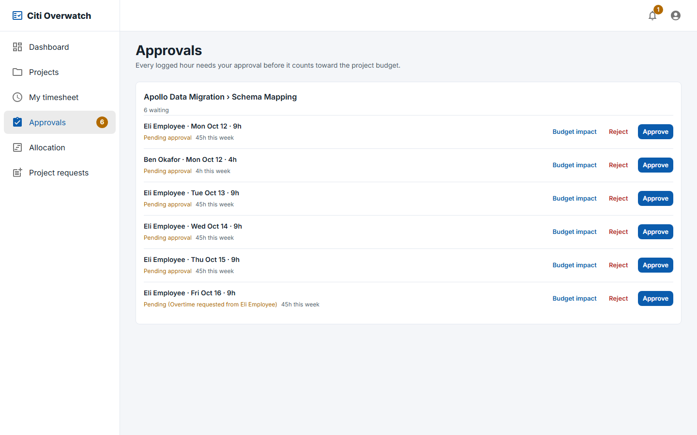
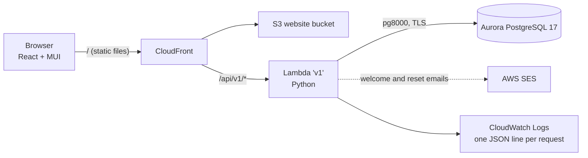

# Citi Overwatch

A project tracking platform for ACME Inc. It gives admins, project managers and employees one place to manage projects, milestones, people, hours and budgets, and it answers the seven questions in the [workshop brief](docs/project/REQUIREMENTS.md) on a single live dashboard.


| | |
|---|---|
| **Live site** | https://d3ucnz03j0sngl.cloudfront.net |
| **Stack** | React 19 · Material UI 9 · React Responsive · Python 3 on AWS Lambda · Aurora PostgreSQL 17 |
| **Tests** | 291 backend (97% coverage, business rules 100%) · 84 frontend component · 6 end-to-end (desktop + mobile) — see [TESTING.md](docs/project/TESTING.md) |

## What it does

| The brief asks… | Where Citi Overwatch answers it |
|---|---|
| Q1 What is the status of each active project? | Dashboard status counts and project table (progress, budget used, due date) |
| Q2 Which projects are at risk of missing their deadlines? | Dashboard at-risk list; every reason is shown as a badge (overdue milestone, past due, budget burning faster than progress) |
| Q3 How are resources allocated across projects? | **Allocation** page: people × projects, planned vs logged hours, utilization |
| Q4 What are the key deliverables and their completion status? | Milestones on each project, plus overdue and due-soon lists on the dashboard |
| Q5 Which team members are over-allocated? | Dashboard "over 40h this week" list; the manager gets one alert per person-week |
| Q6 What is the dependency chain between deliverables? | Each project's timeline: date bars in dependency order, "after …" chains, automatic **blocked** status |
| Q7 How much budget has been consumed versus planned? | Dashboard bar chart (planned, consumed, forecast) and each project's Budget tab |

Highlights:

- **Three roles.** Admin, manager and employee, enforced on the server and reflected in the UI ([permission matrix](docs/project/USER_STORIES.md#roles-at-a-glance)).
- **Accounts.** Admins create them in a five-step wizard with live username checks and a generated password. The welcome email carries a temporary password, which must be changed at first sign-in.
- **Timesheets.** People log hours on the milestones they're assigned to. Every hour needs the project manager's approval before it counts toward the budget. Going over 40 hours is a warning, not a block.
- **Approvals.** Each pending entry shows its budget impact: the cost of the request, the remaining budget before and after, and a 4-week-pace forecast.
- **Nothing is ever deleted.** Records are archived and an admin can restore them. Every change is written to the **audit log**.
- **Responsive.** A sidebar on desktop, a drawer on phones, and tables that become cards on small screens.

<p>
  
  
</p>

## Architecture



One Python Lambda (`backend/v1`) serves the whole API, organized by feature, with the business rules kept as pure functions in `app/rules/`. The React app is a static build on S3 behind the same CloudFront distribution, so the browser only ever talks to one origin. More detail is in [ARCHITECTURE.md](docs/project/ARCHITECTURE.md).

## Quick start (Windows, Git Bash)

You need **PostgreSQL 17** (local superuser password `postgres`), **Python 3.12+** and **Node 20.19+**.

```bash
# 1. Backend: install, then start the API on :3001 with fresh demo data
cd backend/v1
python -m pip install -r requirements.txt -r requirements-dev.txt
python scripts/devserver.py --reset --seed      # creates and migrates the overwatch_dev database

# 2. Frontend, in a second terminal: start Vite on :3000 (it proxies /api to :3001)
cd frontend
npm install
npm run dev
```

Open http://localhost:3000 and sign in with a demo login. Locally, emails aren't sent. They're written to `backend/v1/.outbox/` as text files, so you can read a new user's temporary password there.

| Role | Username | Password |
|---|---|---|
| Admin | `admin.demo2`, `admin.demo3`, `admin.demo4` | Private, held by the owner (live site) |
| Manager | `manager.demo` | `Demo123!` |
| Employee | `employee.demo` | `Demo123!` |
| Executive (read-only) | `executive.demo` | `Demo123!` |

The three published demo logins never lock and can't change their password, so nobody can lock graders out. The executive sees every project, workload, the archive and the audit log but never a salary or hourly rate, and can't change anything; on the live site it's created by the `demo_backfill` operation. On the live site, the other seeded accounts get random passwords. The admin logins were created with the `create_admins` operation (see [Deploy to AWS](#deploy-to-aws)); the local seed's admin login is defined in `backend/v1/app/seed.py`.

Other useful commands:

```bash
python scripts/migrate.py --db overwatch_dev         # apply migrations without starting the server
python scripts/devserver.py                          # restart without wiping data
```

Optional: to have the live site email sign-in details from the admin's browser (the Lambda has no internet route for email), copy `frontend/.env.example` to `frontend/.env.production.local` and fill in the EmailJS IDs before deploying the frontend. See [DECISIONS.md](docs/project/DECISIONS.md).

Connection settings come from `POSTGRES_HOST`, `POSTGRES_PORT`, `POSTGRES_USER`, `POSTGRES_PASS` and `POSTGRES_NAME` (defaults: `localhost`, `5432`, `postgres`, `postgres`, `overwatch_dev`).

## Tests

```bash
cd backend/v1 && python -m pytest --cov=app              # 291 unit + integration tests against local Postgres
cd frontend && npm test                                  # 84 component tests (Vitest + Testing Library)
cd frontend && npx playwright install chromium webkit    # once
cd frontend && npm run e2e                               # 3 journeys × desktop Chrome and iPhone 13 (WebKit)
cd frontend && npm run lint
```

The end-to-end run starts its own API on a fresh `overwatch_e2e` database. Results, coverage and known gaps are recorded in [TESTING.md](docs/project/TESTING.md).

## Deploy to AWS

The workshop environment provides the AWS account, Terraform and the deploy scripts in `bin/`.

```bash
./bin/deploy-backend.sh                  # Terraform: packages backend/v1 into the 'v1' Lambda

# Aurora isn't reachable from a laptop, so migrations and demo data run inside the Lambda
# through a direct, IAM-authorized invoke (HTTP requests can't trigger these operations):
aws lambda invoke --function-name coding-workshop-v1-<suffix> \
  --cli-binary-format raw-in-base64-out --payload '{"op":"migrate"}' out.json && cat out.json
aws lambda invoke --function-name coding-workshop-v1-<suffix> \
  --cli-binary-format raw-in-base64-out --payload '{"op":"seed"}' out.json && cat out.json

# Extra admin logins for a demo: each gets a random password, returned only in out.json.
# Usernames that already exist are skipped. Delete out.json once the passwords are saved somewhere safe.
aws lambda invoke --function-name coding-workshop-v1-<suffix>   --cli-binary-format raw-in-base64-out   --payload '{"op":"create_admins","users":[{"username":"admin.demo2","first_name":"Jordan","last_name":"Admin"}]}' out.json

# Demo data seeded before departments, pull mode and difficulty: fills only the blanks (run "migrate" first).
# Safe to run again; it never overwrites what an admin set and never touches assignees or hours.
aws lambda invoke --function-name coding-workshop-v1-<suffix>   --cli-binary-format raw-in-base64-out --payload '{"op":"demo_backfill"}' out.json && cat out.json

./bin/deploy-frontend.sh                 # builds the React app and syncs it to S3 + invalidates CloudFront
```

**Windows notes:** the workshop scripts expect Linux tools. On Windows, put shims for `dig`, `jq`, `terraform` and `python3` in `~/bin`, and run AWS CLI log commands with `MSYS_NO_PATHCONV=1` so Git Bash doesn't rewrite `/aws/lambda/...` paths. The workshop's original setup guide is preserved in [docs/WORKSHOP_README.md](docs/WORKSHOP_README.md).

## Trade-offs and assumptions

- **Milestones are the brief's "deliverables".** It's the instructor's term, and using one entity means nothing is duplicated.
- **`DELETE` archives instead of deleting.** This keeps history and audit trails intact; admins can restore anything.
- **Cost = approved hours × salary ÷ 2,080.** The rate is copied onto each entry when it's approved, so a raise doesn't rewrite past costs. Benefits and overhead aren't modelled.
- **40 hours is a warning for logged time but a hard cap for planned time.** Managers can't plan anyone past 40 hours a week. People can log overtime, which shows as "Pending (Overtime requested from …)" and alerts the manager once.
- **Pure-Python dependencies only** (`pg8000`, `PyJWT`, standard-library PBKDF2), so the Lambda package builds on Windows without Docker.
- **Email on the live site:** the workshop Lambda's VPC has no route to SES. When an email can't be sent, the admin sees the temporary password once, with a copy button. Forgotten-password codes therefore only work locally.

Every decision, with its reasoning and cost, is in [DECISIONS.md](docs/project/DECISIONS.md).

## Documentation

| Document | What's in it |
|---|---|
| [REQUIREMENTS.md](docs/project/REQUIREMENTS.md) | The brief, word for word, and the checklist of what's done |
| [USER_STORIES.md](docs/project/USER_STORIES.md) | Stories per role and page, with acceptance criteria for loading, success and failure |
| [ARCHITECTURE.md](docs/project/ARCHITECTURE.md) | Cloud and local diagrams, request lifecycle, request IDs and logging |
| [DATA_MODEL.md](docs/project/DATA_MODEL.md) | ER diagram and table notes |
| [API.md](docs/project/API.md) | Every endpoint, example requests and responses, error codes |
| [LOGIC_WALKTHROUGH.md](docs/project/LOGIC_WALKTHROUGH.md) | Diagrams of the key flows and rules, linked to the code |
| [TESTING.md](docs/project/TESTING.md) | How to run each test layer, real results, known gaps |
| [DECISIONS.md](docs/project/DECISIONS.md) | Why it's built this way, plus findings from the cloud deploy |
| [STRETCH.md](docs/project/STRETCH.md) | Ideas beyond the minimum |
| [Design spec](docs/superpowers/specs/2026-10-13-citi-overwatch-design.md) | The full design this was built from |
