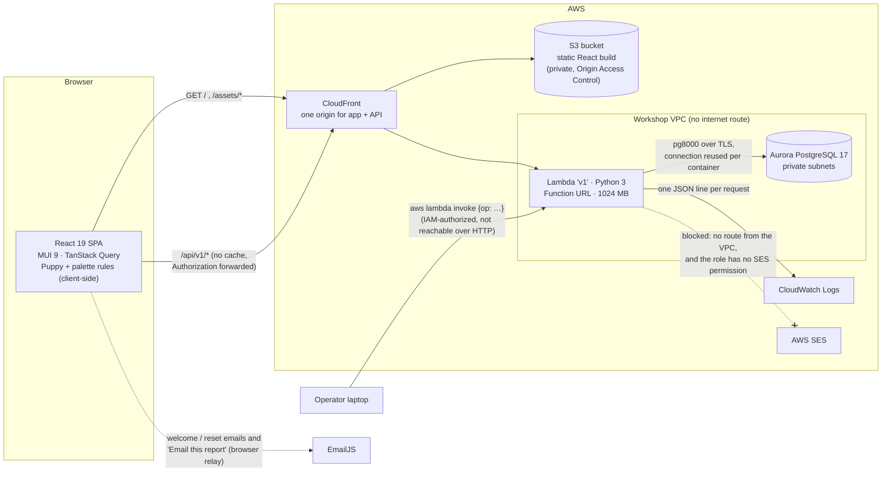
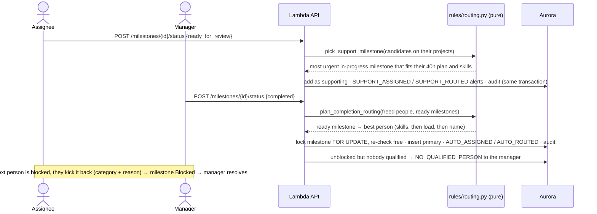
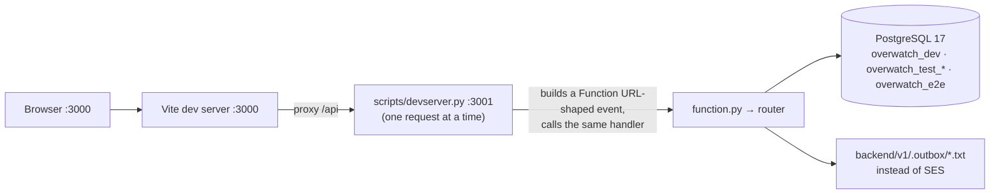
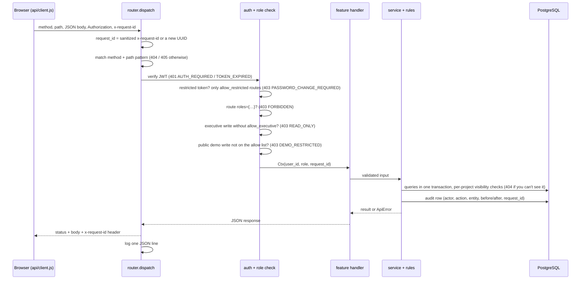

# Architecture

How ACME Scout is put together, as deployed on 2026-10-15. Business rules are explained step by step in [LOGIC_WALKTHROUGH.md](LOGIC_WALKTHROUGH.md); every endpoint is in [API.md](API.md); the tables are in [DATA_MODEL.md](DATA_MODEL.md).

## Components



- **One origin.** CloudFront serves the static app from S3 and routes `/api/v1*` to the Lambda's Function URL, so the browser never makes cross-origin calls to the API and the refresh cookie can be `SameSite=Strict`. A CloudFront Function (`spa_routes`) rewrites extension-less paths to `/index.html` on the S3 behaviour only, so deep links work and API `403`/`404`s are never rewritten.
- **One Lambda for the whole API.** `backend/v1` (114 routes, 66 of them writes) is discovered by its `requirements.txt` and packaged by `bin/deploy-backend.sh` (Terraform). Its dependencies are pure Python (`pg8000`, `PyJWT`, standard-library PBKDF2), so it builds on Windows without Docker. Memory is 1024 MB because Lambda CPU scales with memory: PBKDF2 at 600k iterations took about 4.4 s at 128 MB and takes about 0.75 s warm now ([DECISIONS.md](DECISIONS.md)).
- **No internet from the Lambda.** The function runs in the workshop VPC with no NAT and no VPC endpoints, and it uses the platform's pre-made role (`create_role = false` in `infra/lambda.tf`), which carries no SES permission. Server-side email therefore fails fast (one try, a 1-second connect timeout, a 10-minute cooldown, `app/email.py`). The fix needs the instructors: an SES VPC interface endpoint plus the permission.
- **Email from the browser.** When the server answers `email_sent: false` for a new account or an admin password reset, the admin's browser sends it through one fixed EmailJS template ([`lib/emailRelay.js`](../../frontend/src/lib/emailRelay.js)); if that is off or fails, the admin sees the temporary password once. "Email this report" builds the dashboard report in the browser and sends it the same way (a delivery result per recipient). Forgotten-password codes are never relayed.
- **No AI service.** With no internet route there is nothing to call, so smart insights are server-side rules (`app/rules/insights.py`), and Puppy and the command palette's phrase matching are fixed rules running in the browser.
- **Secrets.** Database credentials come from the platform's injected `POSTGRES_*` variables. The JWT signing key is generated by the first migration and kept in `app_secrets`, read once per cold start, so Terraform holds no secret. EmailJS IDs are build-time `VITE_EMAILJS_*` values in an untracked `frontend/.env.production.local`.

## Feature modules (backend)

Each feature is `app/features/<name>/routes.py` (thin: method, path, roles) plus `service.py` (logic, SQL, audit), with pure rules in `app/rules/`.

| Area | Modules | What they do |
|---|---|---|
| **Identity and access** | `auth`, `users`, `avatars`, [`public_demo.py`](../../backend/v1/app/public_demo.py), [`router.py`](../../backend/v1/app/router.py) | Sign-in, rotating refresh cookie, lockout (5 failures → 15 minutes), forced password change, admin resets and forgotten-password codes; the account wizard; one reporting manager per person (never the shared public demo admin); profile photos through the PNG sanitiser ([`rules/png_sanitize.py`](../../backend/v1/app/rules/png_sanitize.py)). The router's executive read-only guard and the public demo guard run before any handler |
| **Projects and planning** | `projects`, `members`, `requests`, `planning`, `departments`, [`presets.py`](../../backend/v1/app/presets.py) | Projects with status counts, budget and a delegate approver; staffing under the 40-hour planned cap; project requests; department presets and project templates (`/project-templates`); the Backlog → Ready → Scheduled board and the finalize checks that move a project from Planned to Active |
| **Milestones** | `milestones` (`service`, `workflow`, `routing`, `notify`), `skills` | Milestones with dependencies (cycle-checked), priority, difficulty, estimates and skills; the status workflow; auto-routing after *Ready for review* (support) and *Completed* (next ready milestone as primary); kickbacks and their resolution; progress updates; history; pull-mode claiming |
| **Time** | `time` (`service`, `timers`, `changes`, `flags`), `hr`, `reminders` | The week grid save, approvals with budget impact, approve week, approved weeks; start/stop timers whose stop keeps a draft that **Save week** submits, locked timer cells and change requests (`changes`), the Live now feed with remote stop, over-limit alerts at 125% of the 8h day, the milestone's estimate or the 40h week, and the midnight auto-stop (all worked out lazily on reads, with no scheduler); proof of work (a note or same-day progress update); red flags for approvers; HR pay-period submissions with corrections; the Friday reminder |
| **Communication** | `messages`, notifications (in `users`/`time`/`milestones` via `notify`) | Conversations, milestone Discuss threads, read receipts and unread counts under [`rules/messaging.py`](../../backend/v1/app/rules/messaging.py); bell notifications with one-time alerts guarded by unique constraints |
| **Insight and history** | `insights` (`service`, `smart`), `activity`, `archive`, audit ([`audit.py`](../../backend/v1/app/audit.py)) | Dashboard, allocation and rule-based smart insights; the Live activity feed scoped in SQL; the archive and restores; the audit log rendered as sentences |

**Puppy** (`frontend/src/features/puppy/`) has no backend module. It reuses the bell's `GET /notifications` poll and the caches the pages already load, cuts everything down to an allow-list of harmless fields ([`privacy.js`](../../frontend/src/features/puppy/privacy.js): no pay, costs, contact details or message bodies), and runs fixed rules for its Summary, Do it (each action confirmed first, including the admins' create-accounts conversation, which calls the same `POST /users` as the People page), Ask and Sound tabs ([LOGIC_WALKTHROUGH §27](LOGIC_WALKTHROUGH.md#27-puppy-the-rule-based-assistant)).

## Operator operations

[`function.py`](../../backend/v1/function.py) treats any event without `requestContext.http` as an internal operation. Requests through the Function URL always carry that field, so these can only be reached by an IAM-authorized `aws lambda invoke` (Aurora isn't reachable from outside the VPC, so this is also the only way to run them).

| `op` | What it does | Safe to repeat? |
|---|---|---|
| `migrate` | Applies `backend/v1/migrations/*.sql` (001–015) in order, recording each | Yes: applied files are skipped |
| `seed` | Loads the demo data, including the curated plans (`demo_curate`) | Yes: it does nothing once the demo data exists |
| `rotate_demo` | Random passwords for every seeded account whose password isn't published | Yes |
| `create_admins` | Admin logins with random passwords, returned only to the operator | Yes: existing usernames are skipped |
| `demo_backfill` | Fills blanks in older demo data (departments, priorities, `executive.demo`, `demo.admin`, messages, hour-tracking examples…); never overwrites what someone set | Yes |
| `demo_curate` | Rounds the demo projects out into their department plans; additive and archive-only. A dry run unless `"dry_run": false` | Yes: a second run adds nothing |

The live data is never reset: changes to demo data go through these additive operations, so whatever graders and the owner did on the live site stays.

## Security model

**Roles.** `admin`, `manager`, `employee` and `executive`, plus the `is_public_demo` flag on an account whose password is published (`demo.admin` and the other demo logins). The full matrix is in [LOGIC_WALKTHROUGH §16](LOGIC_WALKTHROUGH.md#16-roles-and-the-executives-read-only-guard) and [USER_STORIES.md](USER_STORIES.md#roles-at-a-glance).

| Layer | Where | Rule |
|---|---|---|
| Authentication | `router.py`, `security.py` | 15-minute access token in memory; `HttpOnly`, `SameSite=Strict` refresh cookie scoped to `/api/v1/auth`, rotated on use. Restricted tokens (temporary password) reach only `allow_restricted` routes |
| Role gate | `route(..., roles=)` | Coarse: e.g. `roles={"admin"}` → `403 FORBIDDEN` |
| Record checks | [`authz.py`](../../backend/v1/app/authz.py) | Fine: can this person see or manage this project, milestone or profile? Records you can't see are `404`, so ids reveal nothing |
| Executive guard | `router.py` `_guard` | Every `POST/PUT/PATCH/DELETE` is `403 READ_ONLY` unless the route opts in (`allow_executive`: own account, photo, notifications, messages). Every JSON response to an executive has salary and hourly-rate keys removed at any depth |
| Public demo guard | [`public_demo.py`](../../backend/v1/app/public_demo.py) | Writes are refused by name (passwords, credentials, HR), then by a deny list, then allowed only from an allow list; anything unlisted is refused (`403 DEMO_RESTRICTED`). Sessions end 5 minutes after sign-in however often they refresh; no lockout, but 20 sign-ins per minute per client address |
| Fail-closed tests | `tests/integration/test_public_demo.py`, `test_executive.py` | Both walk every registered write route: a new route that isn't classified for the public demo, or that opts in for executives without being on the expected list, fails the suite |
| Pay redaction | `authz.redact_pay`, services | Only admins (and the person themselves) see a salary or hourly rate. Managers see an entry's cost, never the rate; executives see neither; the audit log and activity feed never put pay in a sentence |
| Uploads | [`rules/png_sanitize.py`](../../backend/v1/app/rules/png_sanitize.py) | Profile photos: PNG only, ≤ 300 KB, 16–512 px a side; every chunk is validated and the image is rebuilt from its pixels (metadata and anything after `IEND` refused or dropped), pure Python |
| Exports | [`lib/csv.js`](../../frontend/src/lib/csv.js) | CSVs (projects, audit, approvals, payroll) are built in the browser; a text cell starting with `= + - @`, tab or CR is prefixed with `'` so spreadsheets never run it as a formula |
| Rate limits | `auth/service.py`, `rules/messaging.py` | Account lockout after 5 failed sign-ins (15 minutes); public demo sign-ins 20/minute per address (`429`); messages 20 per person per rolling minute (`429`) |
| Messaging | [`rules/messaging.py`](../../backend/v1/app/rules/messaging.py) | Admins, executives and managers may start a conversation with anyone active; employees only with their own manager, their projects' managers and active delegates, and other employees |
| Concurrency | services | Race-prone steps are single atomic `UPDATE … RETURNING` statements, row locks (`FOR UPDATE`: per-person time saves and timers, HR submissions, completion routing) or unique constraints (one alert per person-week, one running timer, one pending change request per cell, one over-limit alert per timer and limit, one open kickback) |
| Passwords | `security.py` | PBKDF2-SHA256, 600,000 iterations; unknown usernames are checked against a dummy hash so timing reveals nothing; temporary passwords expire after 72 hours |

The frontend's [`lib/permissions.js`](../../frontend/src/lib/permissions.js) and [`app/access.js`](../../frontend/src/app/access.js) mirror these rules to hide or disable controls (with a tooltip for demo-restricted ones), but the server is the authority.

## Key journeys

### Log hours → approve → HR

```mermaid
sequenceDiagram
  actor E as Employee
  actor M as Manager / delegate
  actor H as Admin
  participant API as Lambda API
  participant DB as Aurora

  E->>API: POST /timers {milestone_id} … POST /timers/stop {note}
  API->>DB: lock person row · round to 0.25h · keep it on the timer as a draft (no entry written)
  M->>API: GET /timers/live (Live now) · optional POST /timers/{id}/stop-remote {message}
  E->>API: PUT /time-entries (week grid; timer cells locked at saved + draft; a note per new or changed cell)
  API->>API: validate cells · 24h/day · project open · locked cells unchanged (409 TIMER_HOURS_LOCKED) · proof of work (400 PROOF_REQUIRED)
  API->>DB: upsert entries → pending · drafts submitted · freeze over_40 · one overtime alert per person-week · audit
  E->>API: POST /time-edit-requests (to change a locked cell) → M approves or rejects
  M->>API: GET /approvals (grouped by person-week, with flags and tracked share)
  API->>DB: load entries + red flags (same hours daily, long day, over plan, no proof…)
  M->>API: POST /time-entries/{id}/approve {hours seen} or /approvals/approve-week
  API->>DB: UPDATE … WHERE still pending with those hours (409 STALE_ENTRY otherwise) · copy hourly_rate · audit
  H->>API: POST /hr-submissions {period}
  API->>DB: lock approved, unsent entries FOR UPDATE · copy rows into hr_submission_entries · audit
  H->>H: Payroll CSV built in the browser (formula-safe)
  E->>API: later edit of a sent entry
  API->>DB: back to pending · changed_after_hr_submission → re-sent as a correction next time
```

### Complete a milestone → auto-route



Details: [LOGIC_WALKTHROUGH §5](LOGIC_WALKTHROUGH.md#5-time-approval-and-the-over-40-hour-alert), [§5a](LOGIC_WALKTHROUGH.md#5a-timesheet-lifecycle-draft--pending--approved--submitted-to-hr), [§9](LOGIC_WALKTHROUGH.md#9-auto-routing-after-ready-for-review-and-completed), [§9b](LOGIC_WALKTHROUGH.md#9b-kickbacks-and-escalation) and [§28](LOGIC_WALKTHROUGH.md#28-hour-tracking-safeguards-timers-proof-of-work-red-flags).

## Locally



The dev server wraps the **same** `handler(event)` that runs in Lambda. Routing, auth, validation and errors behave exactly as they do in the cloud; only the email transport differs.

## Request lifecycle



Layers, from outside in:

| Layer | File | Responsibility |
|---|---|---|
| Entry | [`function.py`](../../backend/v1/function.py) | Internal operations (see [Operator operations](#operator-operations)) vs HTTP |
| HTTP | [`app/http.py`](../../backend/v1/app/http.py) | Parses the event, builds JSON responses, defines `ApiError` and the error envelope |
| Router | [`app/router.py`](../../backend/v1/app/router.py) | `route(method, pattern, auth=, roles=, allow_restricted=, allow_executive=)` registry, authentication, role gate, executive and public demo guards, pay stripping for executives, request ID, logging |
| Auth helpers | [`app/authz.py`](../../backend/v1/app/authz.py) | "Can this person see or manage this project/milestone?", in one place |
| Features | [`app/features/*/`](../../backend/v1/app/features/) | `routes.py` (thin) + `service.py` (logic), per feature: activity, archive, auth, avatars, departments, hr, insights, members, messages, milestones, planning, projects, reminders, requests, skills, time, users (see [Feature modules](#feature-modules-backend)) |
| Rules | [`app/rules/`](../../backend/v1/app/rules/) | Pure functions: at-risk, overtime, cycles, capacity, usernames, milestone status, priority, routing, claims, estimates, planning checks, messaging, insights, timesheets and reminders, time tracking (timer drafts and locks), timer limits, hour flags, PNG sanitising |
| Data | [`app/db.py`](../../backend/v1/app/db.py), [`app/dberrors.py`](../../backend/v1/app/dberrors.py) | Connections, transactions, query helpers; unique violations → `409`, constraint failures → `400` |
| Cross-cutting | [`audit.py`](../../backend/v1/app/audit.py), [`email.py`](../../backend/v1/app/email.py), [`security.py`](../../backend/v1/app/security.py), [`validation.py`](../../backend/v1/app/validation.py) | Audit log, email, hashing and tokens, field validators |

Permissions are enforced at two levels:
- **Coarse:** a role gate on the route, such as `roles={"admin"}`.
- **Fine:** per-record checks in `authz.py`. A manager can only change their own projects, and an employee can only change milestones they're assigned to.

The UI's [`lib/permissions.js`](../../frontend/src/lib/permissions.js) mirrors these checks to hide or disable controls, but the server is the authority.

## Request IDs and logging

- **Every request gets a `request_id`.**
  - It's the client's `x-request-id` header when one is sent. The value is sanitized to `[A-Za-z0-9-]{1,64}`, so a forged ID can't inject anything into the logs.
  - Otherwise it's a new UUID.
  - It's returned in the `x-request-id` response header and inside every error body.
- **The frontend shows the `request_id` in error banners.** A user can quote it, and the matching log line is one search away:

  ```bash
  MSYS_NO_PATHCONV=1 aws logs filter-log-events --log-group-name /aws/lambda/coding-workshop-v1-<suffix> \
    --filter-pattern '"<request_id>"'
  ```

- **Each request writes one JSON log line:**

  ```json
  {"ts": "2026-10-13T21:40:39.528778+00:00", "level": "info", "msg": "request",
   "request_id": "71ae9b0f-9ed6-4728-a37f-3c3cba155575", "method": "GET", "path": "/auth/me",
   "status": 404, "duration_ms": 0.1, "code": "NOT_FOUND"}
  ```

  The request line doesn't carry the user's ID; to find who did something, use the audit log, which records the actor alongside the same `request_id`.
- **Unexpected exceptions** are logged with a stack trace, but the response is a generic `500 INTERNAL_ERROR` that never exposes internals.
- **Passwords, codes and tokens are never logged.**

## Frontend structure

```
frontend/src/
  app/         App routes, Layout (sidebar ⇄ drawer at md, Theme menu), access rules per route, nav, theme and colour mode,
               the demo-session banner and countdown, providers, query client, toasts
  api/         client.js (bearer token, request IDs, single shared refresh, ApiError) · queries.js (TanStack Query hooks)
  auth/        SessionProvider, RequireAuth (role-gated routes), ForcePasswordChange
  components/  ErrorAlert, EmptyState, ConfirmDialog, StatusChip, PriorityChip, DifficultyChip, RiskBadges, ResponsiveTable,
               Timeline, NotificationBell, DemoLock, ExportCsvButton, PrintButton, …
  features/    login, home (My week, Control centre), dashboard, projects, planning, milestones, timesheet, timer,
               timesheets (To review, Approved, HR submission), approvals, allocation, requests, people, profile, skills,
               departments, messages, puppy, palette, report, activity, audit, archive, avatar
  lib/         permissions, labels, formatters, Zod schemas, csv (formula-safe), emailRelay (EmailJS), messaging, workflow,
               estimates, demoSession, responsive breakpoint
```

- **Server state lives only in TanStack Query.** Every mutation invalidates the queries it affects, and everything refetches every 30 seconds and when the tab regains focus (Messages polls faster while open).
- **Responsive switching** uses React Responsive's `useMediaQuery` at the MUI `md` breakpoint. [`ResponsiveTable`](../../frontend/src/components/ResponsiveTable.jsx) renders a DataGrid on desktop and cards on phones.
- **Colour language.** Status, priority, difficulty and severity never share a colour family: priority is red/amber with a flag or chevron and reads "High Priority"; difficulty is a teal ramp with weight dots and reads "Hard Difficulty"; insight severity reads "High Severity". See [DECISIONS.md](DECISIONS.md).
- **Dark mode** follows the operating system by default; the account menu's Theme switch (or the palette's "dark mode") overrides it per browser.
