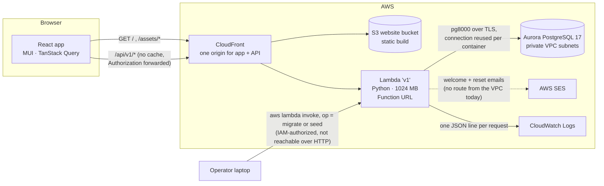
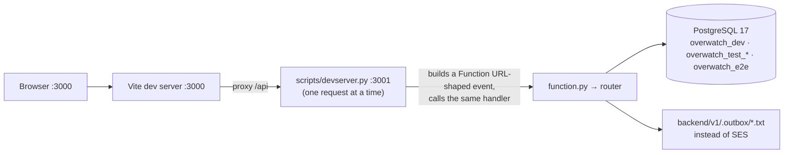
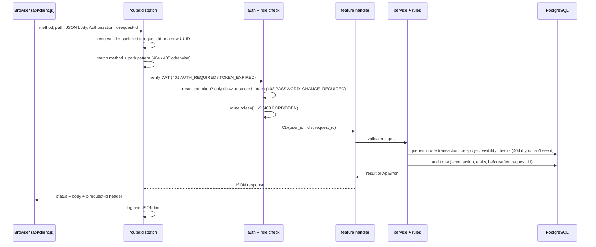

# Architecture

## In the cloud



- **One origin.** CloudFront serves the static app and routes `/api/v1*` to the Lambda's Function URL, so the browser never makes cross-origin calls. The refresh cookie can then be `SameSite=Strict`.
- **One Lambda for the whole API.** `backend/v1` is discovered by its `requirements.txt` and packaged by `bin/deploy-backend.sh` (Terraform). Its dependencies are pure Python (`pg8000`, `PyJWT`), so it builds on Windows without Docker.
- **Migrations and seeding** run inside the Lambda through a direct invoke, because Aurora isn't reachable from outside the VPC. [`function.py`](../../backend/v1/function.py) treats any event without `requestContext.http` as an internal operation. Requests that come through the Function URL always carry that field, so they can never trigger these operations.
- **Secrets:**
  - The database credentials come from the platform's injected `POSTGRES_*` variables.
  - The JWT signing key is generated by the first migration and stored in `app_secrets`. It's read once per cold start, so no secret needs to be set in Terraform.
- **Memory is 1024 MB.** Lambda CPU scales with memory, and PBKDF2 at 600k iterations took about 4.4 s at 128 MB. It now takes about 0.75 s warm. See [DECISIONS.md](DECISIONS.md).

## Locally



The dev server wraps the **same** `handler(event)` that runs in Lambda. Routing, auth, validation and errors behave exactly as they do in the cloud; only the email transport differs.

## Request lifecycle



Layers, from outside in:

| Layer | File | Responsibility |
|---|---|---|
| Entry | [`function.py`](../../backend/v1/function.py) | Internal operations vs HTTP |
| HTTP | [`app/http.py`](../../backend/v1/app/http.py) | Parses the event, builds JSON responses, defines `ApiError` and the error envelope |
| Router | [`app/router.py`](../../backend/v1/app/router.py) | `route(method, pattern, auth=, roles=, allow_restricted=)` registry, authentication, role gate, request ID, logging |
| Auth helpers | [`app/authz.py`](../../backend/v1/app/authz.py) | "Can this person see or manage this project/milestone?", in one place |
| Features | [`app/features/*/`](../../backend/v1/app/features/) | `routes.py` (thin) + `service.py` (logic), per feature: auth, users, requests, projects, members, milestones, time, insights |
| Rules | [`app/rules/`](../../backend/v1/app/rules/) | Pure functions: at-risk, overtime, cycles, capacity, usernames, milestone status |
| Data | [`app/db.py`](../../backend/v1/app/db.py), [`app/dberrors.py`](../../backend/v1/app/dberrors.py) | Connections, transactions, query helpers; unique violations → `409`, constraint failures → `400` |
| Cross-cutting | [`audit.py`](../../backend/v1/app/audit.py), [`email.py`](../../backend/v1/app/email.py), [`security.py`](../../backend/v1/app/security.py), [`validation.py`](../../backend/v1/app/validation.py) | Audit log, email, hashing and tokens, field validators |

Permissions are enforced at two levels:
- **Coarse:** a role gate on the route, such as `roles={"admin"}`.
- **Fine:** per-record checks in `authz.py`. A manager can only change their own projects, and an employee can only change milestones they're assigned to.

The UI's [`lib/permissions.js`](../../frontend/src/lib/permissions.js) mirrors these checks to hide or disable controls, but the server is the authority.

## Request IDs and logging

- **Every request gets a `request_id`.**
  - It's the client's `x-request-id` header when one is sent. The value is sanitized to `[A-Za-z0-9-]{1,64}`, so a forged ID can't inject anything into the logs.
  - Otherwise it's a new UUID.
  - It's returned in the `x-request-id` response header and inside every error body.
- **The frontend shows the `request_id` in error banners.** A user can quote it, and the matching log line is one search away:

  ```bash
  MSYS_NO_PATHCONV=1 aws logs filter-log-events --log-group-name /aws/lambda/coding-workshop-v1-<suffix> \
    --filter-pattern '"<request_id>"'
  ```

- **Each request writes one JSON log line:**

  ```json
  {"ts": "2026-10-13T21:40:39.528778+00:00", "level": "info", "msg": "request",
   "request_id": "71ae9b0f-9ed6-4728-a37f-3c3cba155575", "method": "GET", "path": "/auth/me",
   "status": 404, "duration_ms": 0.1, "code": "NOT_FOUND"}
  ```

  The request line doesn't carry the user's ID; to find who did something, use the audit log, which records the actor alongside the same `request_id`.
- **Unexpected exceptions** are logged with a stack trace, but the response is a generic `500 INTERNAL_ERROR` that never exposes internals.
- **Passwords, codes and tokens are never logged.**

## Frontend structure

```
frontend/src/
  app/         App routes, Layout (sidebar ⇄ drawer at md), theme, providers, query client, toasts
  api/         client.js (bearer token, request IDs, single shared refresh, ApiError) · queries.js (every TanStack Query hook)
  auth/        SessionProvider, RequireAuth (role-gated routes), ForcePasswordChange
  components/  ErrorAlert, EmptyState, ConfirmDialog, StatusChip, RiskBadges, ResponsiveTable, Timeline, NotificationBell, …
  features/    dashboard, projects, milestones, timesheet, approvals, allocation, requests, people, profile, audit, login
  lib/         permissions, formatters, Zod schemas, labels, responsive breakpoint
```

- **Server state lives only in TanStack Query.** Every mutation invalidates the queries it affects, and everything refetches every 30 seconds and when the tab regains focus.
- **Responsive switching** uses React Responsive's `useMediaQuery` at the MUI `md` breakpoint. [`ResponsiveTable`](../../frontend/src/components/ResponsiveTable.jsx) renders a DataGrid on desktop and cards on phones.
