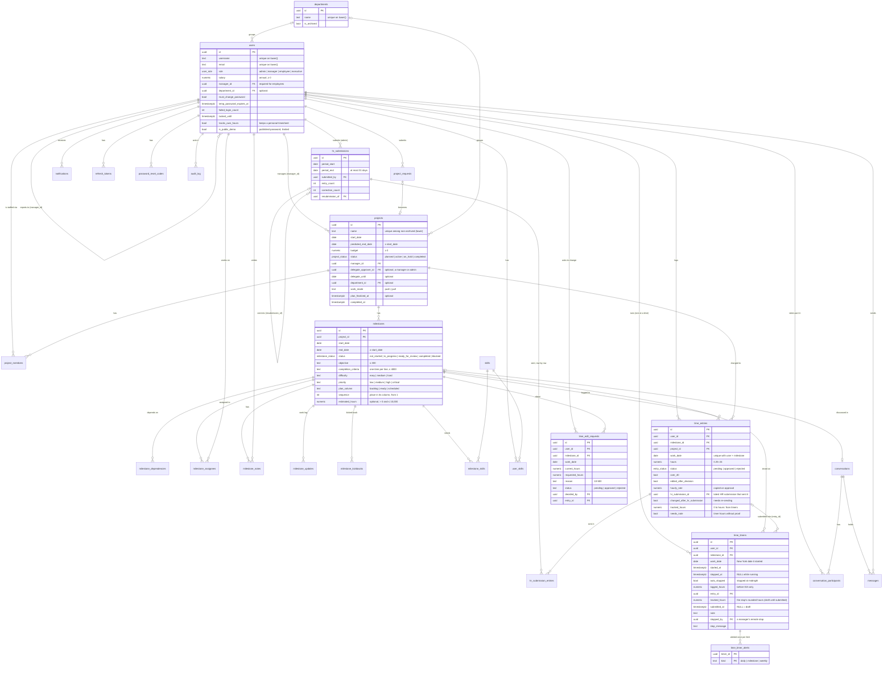

# Data model

The schema lives in numbered migrations: [`001_init.sql`](../../backend/v1/migrations/001_init.sql) creates everything, [`002_assignee_role.sql`](../../backend/v1/migrations/002_assignee_role.sql) adds the assignee role, [`003_milestone_difficulty.sql`](../../backend/v1/migrations/003_milestone_difficulty.sql) adds milestone difficulty, [`004_departments_work_mode.sql`](../../backend/v1/migrations/004_departments_work_mode.sql) adds departments and each project's push/pull work mode, [`005_user_avatars.sql`](../../backend/v1/migrations/005_user_avatars.sql) adds profile photos, [`006_executive_delegates.sql`](../../backend/v1/migrations/006_executive_delegates.sql) adds the `executive` role and each project's delegate approver, [`007_messages.sql`](../../backend/v1/migrations/007_messages.sql) adds messages, [`008_milestone_priority.sql`](../../backend/v1/migrations/008_milestone_priority.sql) adds milestone priority, [`009_milestone_workflow.sql`](../../backend/v1/migrations/009_milestone_workflow.sql) adds the milestone workflow and skills, [`010_milestone_sequence.sql`](../../backend/v1/migrations/010_milestone_sequence.sql) adds the planning board, [`011_timesheet_hr.sql`](../../backend/v1/migrations/011_timesheet_hr.sql) adds HR submissions and `tracks_own_hours`, [`012_demo_accounts.sql`](../../backend/v1/migrations/012_demo_accounts.sql) adds public demo accounts (`is_public_demo`), [`013_milestone_estimates.sql`](../../backend/v1/migrations/013_milestone_estimates.sql) adds `estimated_hours`, [`014_time_tracking.sql`](../../backend/v1/migrations/014_time_tracking.sql) adds timers, tracked hours, `needs_note` and the `app_settings` table (hour-tracking safeguards), and [`015_timer_workflow.sql`](../../backend/v1/migrations/015_timer_workflow.sql) adds timer drafts, remote stops, over-limit alert bookkeeping and change requests (the timer workflow). They're applied in order by `scripts/migrate.py` locally, and by the `migrate` Lambda invoke in the cloud. Applied migrations are tracked, so running them again is a no-op.

Conventions:

- **Primary keys** are `uuid DEFAULT gen_random_uuid()` and never change.
- **Timestamps:** business tables have `created_at`, and the editable ones also have `updated_at`.
- **Archiving:** archivable tables have `is_archived` and `archived_at`. Nothing is ever hard-deleted: `DELETE` endpoints archive, and admins restore. Archived rows are excluded from every calculation.
- **`CHECK` constraints repeat the validation rules** as a second line of defence: dates in order, hours in range, budgets and salaries ≥ 0, rejections need a reason. A violation that slips past validation becomes a `400`, never a `500`.
- **Money:** amounts are `numeric` (salaries `12,2`, budgets `14,2`). Hourly rates are copied onto each approved time entry.

## Entity relationships

## Tables

### People and access

| Table | Purpose and notes |
|---|---|
| `users` | Every account. `role` is `admin`, `manager`, `employee` or `executive` (read-only leadership, added by migration 006 with `ALTER TYPE … ADD VALUE`, so existing rows are untouched). • Usernames and emails are unique **regardless of case**, through unique indexes on `lower(…)`. • `manager_id` is the reporting manager. The service requires it for employees and accepts only an active manager or admin that isn't a public demo account (`is_public_demo`), since a shared login must manage nobody. • `must_change_password` and `temp_password_expires_at` (72 h) drive the forced change. • `failed_login_count` and `locked_until` drive the 15-minute lockout. • `department_id` (optional) is set by an admin. • `tracks_own_hours` (migration 011): whether the person keeps a personal timesheet. Employees always log (it's `true` for them); a manager or admin logs only when an admin turns it on; executives never. Migration 011 set it for every employee and for managers and admins who had already logged hours. • `is_public_demo` (migration 012, default `false`): the account's password is published (the sign-in page's **Admin** demo button, `demo.admin`). [`app/public_demo.py`](../../backend/v1/app/public_demo.py) refuses its dangerous writes and its sessions end five minutes after sign-in; see [LOGIC_WALKTHROUGH §26](LOGIC_WALKTHROUGH.md#26-the-public-demo-admin). Every other account stays a normal one. • `avatar_updated_at` is set while the person has a profile photo; it's the photo's version in `avatar_url`. • Indexed on `manager_id` and `department_id`. |
| `user_avatars` | One profile photo per person (`user_id` is the primary key, deleted with the user). `png` is the sanitised PNG the server rebuilt, never the uploaded bytes; a `CHECK` caps it at 1 MB. Kept out of `users` so the many `SELECT * FROM users` reads never carry image bytes. Added by migration `005_user_avatars.sql`. |
| `departments` | Admin-managed groups for people and projects. The name is unique **regardless of case** (unique index on `lower(name)`, archived ones included). Archiving hides a department from the pickers and the dashboard filter; people and projects already in it keep it until someone changes them. |
| `refresh_tokens` | One row per session. Only `token_hash` (unique) is stored. `revoked_at` is set on rotation, logout, password change and reset. • `session_expires_at` (migration 012): when a public demo session ends for good; set at sign-in and copied, never moved, onto each refreshed token. `NULL` for everyone else. |
| `demo_login_attempts` | Sign-in attempts on public demo accounts, per client address (`client`, `attempted_at`), for a rate limit of 20 a minute: those accounts never lock. Rows older than a minute are deleted as new ones arrive. Indexed on `(client, attempted_at)`. Added by migration 012. |
| `password_reset_codes` | The hashed 6-digit code, with `expires_at` (15 min), `attempts` (locks at 5) and `used_at` (single use). Indexed on `(user_id, created_at DESC)`, which makes the resend limit cheap to check. |
| `app_secrets` | `name → value`. Holds the JWT signing key, which the first migration generates. |
| `app_settings` | Named settings (migration 014): `name` (primary key), `value` (text), `updated_at`. `hour_flags_live_since`: when the red flags went live (migration 014 sets it once; a fresh demo seed moves it to the end of the seed). `NO_ACTIVITY` and `BACKDATED` judge only entries created from then on. |

### Projects and staffing

| Table | Purpose and notes |
|---|---|
| `projects` | The project's name (unique among non-archived projects, by a partial unique index on `lower(name)`), dates, budget, status and its one manager. `completed_at` is set when the project is completed. • `department_id` (optional) is set by the project's manager or an admin. • `work_mode` is `push` (the default: the manager assigns milestones) or `pull` (team members claim ready milestones, see [LOGIC_WALKTHROUGH §11](LOGIC_WALKTHROUGH.md#11-pull-mode-claiming-a-milestone)); a `CHECK` allows only those two. • `delegate_approver_id` and `delegate_until` (migration 006, both optional): one other active manager or admin who may decide the project's pending hours while `delegate_until` is empty or today or later. A `CHECK` forbids an end date without a delegate; the service checks the delegate's role and that it isn't the project's manager. Partial index on `delegate_approver_id`. See [LOGIC_WALKTHROUGH §17](LOGIC_WALKTHROUGH.md#17-delegate-approver). • `plan_finalized_at` (migration 010, optional): when the planning board's plan was finalized, which also moved the project from `planned` to `active`. Empty for projects that never went through the board. See [LOGIC_WALKTHROUGH §25](LOGIC_WALKTHROUGH.md#25-the-planning-board-and-finalizing-a-plan). |
| `project_requests` | A manager's proposal: name, description, proposed dates and budget, `department_id` (optional) and `work_mode` (`push`/`pull`), which the project starts with. `reason` is nullable since migration 011 and no longer asked for (older requests keep theirs). `status` is `pending`, `approved` or `rejected`, and the row records `decided_by`, `decided_at` and `decision_comment`. On approval, `project_id` links to the project it created. |
| `project_members` | Staffing. `(project_id, user_id)` is unique, and `planned_hours_per_week` must be more than 0 and at most 40. The cross-project 40-hour cap is checked in the service, because it depends on which projects' dates overlap. |

### Milestones

| Table | Purpose and notes |
|---|---|
| `milestones` | The brief's deliverables. The stored status is `not_started`, `in_progress`, `ready_for_review`, `completed` or `blocked` (kicked back and waiting for the manager's review; migration 009 added it with `ALTER TYPE … ADD VALUE`). **Waiting on predecessors is never stored**, it's computed. • `objective` (≤ 300) and `completion_criteria` (≤ 4,000, one checklist item per line) default to `''` (migration 009). The service checks that both dates fall within the project's dates. • `difficulty` is `easy`, `medium` (the default) or `hard` (a `CHECK`), weighted 1 / 2 / 3 in progress. Only the project's manager or an admin sets it. • `priority` is `low`, `medium` (the default) or `high` / `critical` (a `CHECK`): how urgent the milestone is, separate from difficulty and never part of progress. It orders auto-routing and the dashboard's deliverables and raises deadline insights. Set by the same people as difficulty. • `plan_column` and `sequence` (migration 010): the milestone's column on the planning board (`backlog`, `ready` or `scheduled`, a `CHECK`; default `scheduled`) and its place in that column (an integer ≥ 0, `NOT NULL`). The migration put every existing milestone in Scheduled, numbered 1, 2, 3… per project by end date. A `BEFORE INSERT` trigger (`milestones_next_sequence`) gives a new milestone without a sequence the next number in its project and column, so it lands at the end. Only the planning board changes them. • `estimated_hours` (migration 013, optional `numeric(7,1)`, `CHECK` more than 0 and at most 10,000): the total person-hours the work should take. `NULL` means no estimate yet. Durations and the project's total estimate are derived from dates and these values, never stored; see [LOGIC_WALKTHROUGH §24](LOGIC_WALKTHROUGH.md#24-expected-time-frame). |
| `milestone_dependencies` | Directed edges: `milestone_id` depends on `depends_on_id`. • The primary key is the pair. • `CHECK` forbids self-dependency. • The service enforces the same-project and no-loop rules (see [LOGIC_WALKTHROUGH §7](LOGIC_WALKTHROUGH.md#7-dependency-loop-detection)). |
| `milestone_assignees` | Who works on a milestone; the primary key is the pair. The person must be a project member. Removing someone from the team removes these links too. • `role` is `primary` (the default, and every assignment a manager makes) or `supporting` (added by [auto-routing](LOGIC_WALKTHROUGH.md#9-auto-routing-after-ready-for-review-and-completed)). Re-saving a milestone's assignees keeps the role of the people who stay. |
| `milestone_notes` | Append-only progress notes, 1–2,000 characters, with `author_id` and the time. |
| `milestone_updates` | The work log (migration 009): `author_id`, `body` (`CHECK` 1–2,000), optional `percent_complete` (`CHECK` 0–100), `created_at`. Indexed on `(milestone_id, created_at DESC)`. |
| `milestone_kickbacks` | Escalations (migration 009): `raised_by`, `category` (`blocker`, `technical_issue`, `unclear_requirement`, `other`), `reason` (`CHECK` 10–2,000), `previous_status`, `raised_at`; then `resolved_by`, `resolution` (`returned` or `requeued`), `resolution_note`, `resolved_at`, all set together (`CHECK`). A partial unique index allows **one open kickback per milestone**. See [LOGIC_WALKTHROUGH §9b](LOGIC_WALKTHROUGH.md#9b-kickbacks-and-escalation). |
| `milestone_skills` | A milestone's required skills, `PRIMARY KEY (milestone_id, skill_id)`. None: anyone on the team qualifies for auto-routing. |

### Skills (migration 009)

| Table | Purpose and notes |
|---|---|
| `skills` | The admin-managed catalogue: `name` (1–60, unique regardless of case via `lower(name)`), `is_archived`. The migration seeds QA, Frontend Development, Backend Development, UI/UX Design, DevOps, Data Engineering, Business Analysis and Project Management. |
| `user_skills` | `PRIMARY KEY (user_id, skill_id)`, `added_by`, `created_at`. Set by admins, or managers for the employees they manage. |

### Time and money

| Table | Purpose and notes |
|---|---|
| `time_entries` | One row per person, milestone and day (`UNIQUE (user_id, milestone_id, work_date)`). • `project_id` is copied from the milestone, so budget queries need no join. • `over_40` is frozen at save time. • `edited_after_decision` drives the "Edited" tag. • `hourly_rate` (salary ÷ 2,080) is copied on approval. • `CHECK` requires a `rejection_reason` on rejected rows. • Indexed on `(user_id, work_date)` for weekly totals and `(project_id, status)` for consumed budget. • HR (migration 011): `hr_submission_id` and `hr_submitted_at` point at the latest HR submission that sent the entry. Sent entries aren't locked; changing one sets `changed_after_hr_submission` and `hr_changed_at` until a later submission re-sends it (`CHECK`: the flag needs `hr_submission_id`). • Hour tracking (migration 014): `note` is the work note (10-500 characters counts as proof of work; new or changed hours need it unless a progress update that day covers them). `tracked_hours` (`numeric(5,2)`, default 0, `CHECK` ≥ 0 and ≤ `hours`) is how much came from timers, giving the derived source label tracked / manual / mixed; a hand edit keeps at most the new hours. `needs_note` (default `false`) marks timer hours saved without proof, which approvers see as "No proof of work". Existing rows became manual, with no note needed. |
| `time_timers` | Start/stop timers (migration 014): `user_id`, `milestone_id`, `work_date` (the New York date it started), `started_at`, `stopped_at` (`NULL` while running), `auto_stopped` (stopped at 23:59:59 of its day because it ran past midnight), and what the stop logged: `logged_hours` and `entry_id` (`ON DELETE SET NULL`, so clearing a draft entry is never blocked). A partial unique index on `user_id WHERE stopped_at IS NULL` allows **one running timer per person**. `CHECK`s: `stopped_at ≥ started_at`, and an auto-stopped timer is stopped. Indexed on `(user_id, started_at DESC)`. • Timer workflow (migration 015): a stop no longer writes an entry. `tracked_hours` (`numeric(5,2)`, default 0, 0-24) is what the stop recorded, a **draft** of that day's cell while `submitted_at` is `NULL`; Submit (or an approved change request) sets `submitted_at` and `entry_id`. `note` (≤ 500) is the stop's note, pre-filling the cell's. `stopped_by` and `stop_message` record a manager's remote stop. Timers from before 015 keep `tracked_hours = 0` (their hours were logged straight away: `logged_hours`, `entry_id`), so none becomes a draft. Partial index on `(user_id, work_date)` for drafts. See [LOGIC_WALKTHROUGH §28](LOGIC_WALKTHROUGH.md#28-hour-tracking-safeguards-timers-proof-of-work-red-flags). |
| `time_timer_alerts` | Migration 015. One row per `(timer_id, kind)` (primary key; `kind` in `daily`, `milestone`, `weekly`) once the approvers were alerted that a running timer passed 125% of that limit, so the alert goes out once. `ON DELETE CASCADE` with the timer. |
| `time_edit_requests` | Migration 015. An employee asking to change a locked (timer) cell: `user_id`, `milestone_id`, `project_id`, `work_date`, `current_hours` (saved + draft when asked), `requested_hours` (`> 0`, ≤ 24), `reason` (10-500), `status` (`pending`/`approved`/`rejected`), `decided_by`, `decided_at` (`CHECK`: set exactly when decided), `decision_comment` (≤ 500), `entry_id` (the entry an approval wrote). A partial unique index on `(user_id, milestone_id, work_date) WHERE status = 'pending'` allows one pending request per cell; indexed on `(project_id, status)`. |
| `hr_submissions` | A pay period an admin handed to HR (migration 011): `period_start`–`period_end` (at most 31 days), `submitted_by`, `submitted_at`, snapshot totals `entry_count`, `correction_count`, `total_hours`, `total_cost`, and `resubmission_of`: the earlier submission its corrections re-send (`NULL` when it has none). |
| `hr_submission_entries` | What each submission sent, row by row and as it was then (`PRIMARY KEY (submission_id, entry_id)`): `hours`, `hourly_rate`, `cost`, `is_correction`, and for corrections `previous_submission_id` and `previous_hours` (`CHECK`: a correction always names the submission it corrects). The payroll CSV is rebuilt from these rows, so a later edit never changes an earlier export. The foreign key also keeps a sent entry from being deleted. |
| `notifications` | In-app alerts. `type` is plain text: `OVER_40H`, `ENTRY_REJECTED`, `SUPPORT_ASSIGNED`, `SUPPORT_ROUTED`, `MILESTONE_CLAIMED`, `TIMESHEET_EMPTY`, `DELEGATE_ASSIGNED`, `AUTO_ASSIGNED`, `AUTO_ROUTED`, `NO_QUALIFIED_PERSON`, `MILESTONE_UPDATE` (one unread per milestone and recipient), `KICKBACK_RAISED`, `KICKBACK_RESOLVED`, `PLAN_FINALIZED`, `TIMER_AUTO_STOPPED` (a timer that ran past midnight), `TIMER_STOPPED_BY_MANAGER`, `TIMER_OVER_LIMIT`, `TIME_EDIT_REQUESTED`, `TIME_EDIT_APPROVED`, `TIME_EDIT_REJECTED` or `MESSAGE_RECEIVED` (`payload.conversation_id`; at most one unread per conversation and recipient, refreshed by each new message). • `UNIQUE (type, subject_user_id, week_start)` guarantees one `OVER_40H` alert per person-week, even if two saves race. • The other types leave `week_start` NULL (NULLs never clash), because they can repeat within a week. A rejection keeps its week in `payload`. • `read_at` marks it read. |

### Messages (migration 007)

| Table | Purpose and notes |
|---|---|
| `conversations` | `created_by`, `created_at`, optional `subject` (≤ 120 characters), `is_group`. • `pair_key` (the two user ids sorted, joined with `:`) is `UNIQUE` and set only on one-to-one conversations, so each pair has exactly one, even if both start it at once. • `milestone_id` is `UNIQUE`: a milestone has at most one discussion. • `last_message_at` orders the inbox (indexed). |
| `conversation_participants` | `PRIMARY KEY (conversation_id, user_id)`, `joined_at`, `last_read_at` (the read receipt and the unread cut-off). Indexed on `user_id` for "my conversations". |
| `messages` | `conversation_id`, `sender_id`, `body` (`CHECK` 1 to 2000 characters), `created_at`. Indexed on `(conversation_id, created_at DESC, id DESC)` for thread pages and `(sender_id, created_at DESC)` for the rate limit. Never edited or deleted. |

### Audit

| Table | Purpose and notes |
|---|---|
| `audit_log` | Append-only: `actor_id`, `action`, `entity_type`, `entity_id`, `changes` (before/after JSON) and `request_id`, so an audit entry can be matched to its log line. There's no update or delete endpoint. |

## How the numbers are derived

| Figure | Formula |
|---|---|
| Hourly rate | `salary ÷ 2,080`, rounded to cents, copied onto the entry when it's approved |
| Consumed budget | `SUM(hours × hourly_rate)` over the project's **approved**, non-archived entries |
| Budget used % | `consumed ÷ budget × 100` |
| Progress % | weight of completed milestones ÷ weight of non-archived milestones × 100, weighted by difficulty (easy 1, medium 2, hard 3); 0 if there are none |
| Week total (for the over-40 flag) | the person's pending + approved hours, Monday–Sunday, across all projects |
| Forecast | consumed + (average approved weekly cost over the last 4 complete weeks × weeks left until the predicted end date) |
| Utilization (Allocation page) | logged hours in the week ÷ 40 |
| Timer hours on a stop | elapsed time to the nearest 0.25h (under 7.5 minutes: nothing), cut so the day stays within 24h; kept as a draft (`time_timers.tracked_hours`) that counts nowhere until **Submit** sends it |
| Over-limit share (running timer) | (hours already used + elapsed) ÷ limit, for the 8h day, the milestone's estimate and the 40h week; the employee is warned at 100%, the approvers alerted once at 125% |
