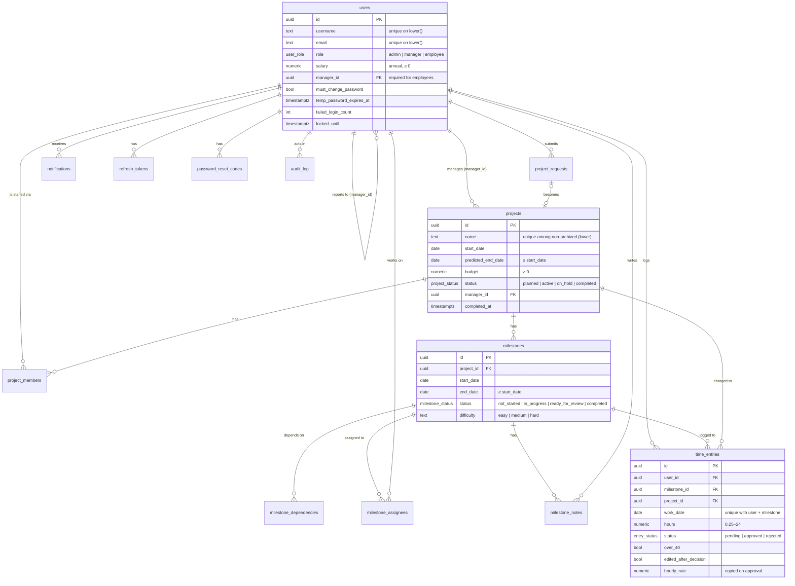

# Data model

The schema lives in numbered migrations: [`001_init.sql`](../../backend/v1/migrations/001_init.sql) creates everything, and [`002_assignee_role.sql`](../../backend/v1/migrations/002_assignee_role.sql) adds the assignee role. They're applied in order by `scripts/migrate.py` locally, and by the `migrate` Lambda invoke in the cloud. Applied migrations are tracked, so running them again is a no-op.

Conventions:

- **Primary keys** are `uuid DEFAULT gen_random_uuid()` and never change.
- **Timestamps:** business tables have `created_at`, and the editable ones also have `updated_at`.
- **Archiving:** archivable tables have `is_archived` and `archived_at`. Nothing is ever hard-deleted: `DELETE` endpoints archive, and admins restore. Archived rows are excluded from every calculation.
- **`CHECK` constraints repeat the validation rules** as a second line of defence: dates in order, hours in range, budgets and salaries ≥ 0, rejections need a reason. A violation that slips past validation becomes a `400`, never a `500`.
- **Money:** amounts are `numeric` (salaries `12,2`, budgets `14,2`). Hourly rates are copied onto each approved time entry.

## Entity relationships

## Tables

### People and access

| Table | Purpose and notes |
|---|---|
| `users` | Every account. • Usernames and emails are unique **regardless of case**, through unique indexes on `lower(…)`. • `manager_id` is the reporting manager. The service requires it for employees. • `must_change_password` and `temp_password_expires_at` (72 h) drive the forced change. • `failed_login_count` and `locked_until` drive the 15-minute lockout. • Indexed on `manager_id`. |
| `refresh_tokens` | One row per session. Only `token_hash` (unique) is stored. `revoked_at` is set on rotation, logout, password change and reset. |
| `password_reset_codes` | The hashed 6-digit code, with `expires_at` (15 min), `attempts` (locks at 5) and `used_at` (single use). Indexed on `(user_id, created_at DESC)`, which makes the resend limit cheap to check. |
| `app_secrets` | `name → value`. Holds the JWT signing key, which the first migration generates. |

### Projects and staffing

| Table | Purpose and notes |
|---|---|
| `projects` | The project's name (unique among non-archived projects, by a partial unique index on `lower(name)`), dates, budget, status and its one manager. `completed_at` is set when the project is completed. |
| `project_requests` | A manager's proposal: name, description, proposed dates and budget, and a reason. `status` is `pending`, `approved` or `rejected`, and the row records `decided_by`, `decided_at` and `decision_comment`. On approval, `project_id` links to the project it created. |
| `project_members` | Staffing. `(project_id, user_id)` is unique, and `planned_hours_per_week` must be more than 0 and at most 40. The cross-project 40-hour cap is checked in the service, because it depends on which projects' dates overlap. |

### Milestones

| Table | Purpose and notes |
|---|---|
| `milestones` | The brief's deliverables. The stored status is one of four values; **blocked is never stored**, it's computed from the predecessors. The service checks that both dates fall within the project's dates. • `difficulty` is `easy`, `medium` (the default) or `hard` (a `CHECK`), weighted 1 / 2 / 3 in progress. Only the project's manager or an admin sets it. |
| `milestone_dependencies` | Directed edges: `milestone_id` depends on `depends_on_id`. • The primary key is the pair. • `CHECK` forbids self-dependency. • The service enforces the same-project and no-loop rules (see [LOGIC_WALKTHROUGH §7](LOGIC_WALKTHROUGH.md#7-dependency-loop-detection)). |
| `milestone_assignees` | Who works on a milestone; the primary key is the pair. The person must be a project member. Removing someone from the team removes these links too. • `role` is `primary` (the default, and every assignment a manager makes) or `supporting` (added by [auto-routing](LOGIC_WALKTHROUGH.md#9-auto-routing-after-ready-for-review)). Re-saving a milestone's assignees keeps the role of the people who stay. |
| `milestone_notes` | Append-only progress notes, 1–2,000 characters, with `author_id` and the time. |

### Time and money

| Table | Purpose and notes |
|---|---|
| `time_entries` | One row per person, milestone and day (`UNIQUE (user_id, milestone_id, work_date)`). • `project_id` is copied from the milestone, so budget queries need no join. • `over_40` is frozen at save time. • `edited_after_decision` drives the "Edited" tag. • `hourly_rate` (salary ÷ 2,080) is copied on approval. • `CHECK` requires a `rejection_reason` on rejected rows. • Indexed on `(user_id, work_date)` for weekly totals and `(project_id, status)` for consumed budget. |
| `notifications` | In-app alerts. `type` is plain text: `OVER_40H`, `ENTRY_REJECTED`, `SUPPORT_ASSIGNED` or `SUPPORT_ROUTED`. • `UNIQUE (type, subject_user_id, week_start)` guarantees one `OVER_40H` alert per person-week, even if two saves race. • The other types leave `week_start` NULL (NULLs never clash), because they can repeat within a week. A rejection keeps its week in `payload`. • `read_at` marks it read. |

### Audit

| Table | Purpose and notes |
|---|---|
| `audit_log` | Append-only: `actor_id`, `action`, `entity_type`, `entity_id`, `changes` (before/after JSON) and `request_id`, so an audit entry can be matched to its log line. There's no update or delete endpoint. |

## How the numbers are derived

| Figure | Formula |
|---|---|
| Hourly rate | `salary ÷ 2,080`, rounded to cents, copied onto the entry when it's approved |
| Consumed budget | `SUM(hours × hourly_rate)` over the project's **approved**, non-archived entries |
| Budget used % | `consumed ÷ budget × 100` |
| Progress % | weight of completed milestones ÷ weight of non-archived milestones × 100, weighted by difficulty (easy 1, medium 2, hard 3); 0 if there are none |
| Week total (for the over-40 flag) | the person's pending + approved hours, Monday–Sunday, across all projects |
| Forecast | consumed + (average approved weekly cost over the last 4 complete weeks × weeks left until the predicted end date) |
| Utilization (Allocation page) | logged hours in the week ÷ 40 |
