# Logic walkthrough

How the key flows and rules work, one diagram each, with links to the code that implements them. Paths are relative to the repo root.

Two patterns recur:

- **Business rules are pure functions** in [`backend/v1/app/rules/`](../../backend/v1/app/rules/). They take plain values, return plain values and never touch the database, so they're tested exhaustively (100% coverage) without one.
- **Race-prone steps are single SQL statements.** A step like "claim this refresh token" or "count this failed attempt" happens in one atomic `UPDATE … RETURNING`, so two requests can't both win.

---

## 1. Account creation and the welcome email

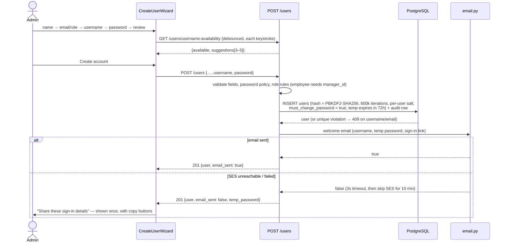

- **Username suggestions:** [`app/rules/usernames.py`](../../backend/v1/app/rules/usernames.py) builds candidates from the name (for Quinn Desktop: `qdesktop`, `quinn.desktop`, `desktopq`, `quinn_desktop`, `quinnd`, then numbered variants). The service drops the taken ones, comparing case-insensitively.
- **Account creation:** [`app/features/users/service.py`](../../backend/v1/app/features/users/service.py) and [`welcome.py`](../../backend/v1/app/features/users/welcome.py).
- **Email:** [`app/email.py`](../../backend/v1/app/email.py). Locally, every email is written to `backend/v1/.outbox/`. In the cloud it goes through SES, with fail-fast timeouts. Email failures never fail the request.
- **The wizard:** [`frontend/src/features/people/CreateUserWizard.jsx`](../../frontend/src/features/people/CreateUserWizard.jsx). **Next** stays disabled until the current step is valid.

## 2. Sign-in, lockout and the forced password change

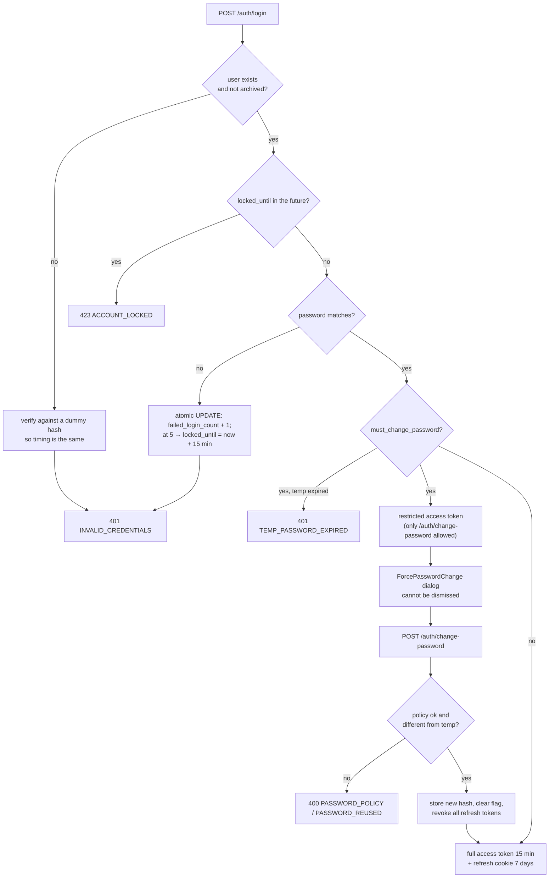

- **Login, the lockout and the password change:** [`app/features/auth/service.py`](../../backend/v1/app/features/auth/service.py).
- **Hashing, tokens and the password policy:** [`app/security.py`](../../backend/v1/app/security.py).
- **The restricted token** carries a claim that the router checks. [`app/router.py`](../../backend/v1/app/router.py) returns `403 PASSWORD_CHANGE_REQUIRED` for every route except the ones marked `allow_restricted=True`.
- **UI:** [`frontend/src/auth/ForcePasswordChange.jsx`](../../frontend/src/auth/ForcePasswordChange.jsx), with the live [`PasswordPolicyChecklist`](../../frontend/src/components/PasswordPolicyChecklist.jsx).

## 3. Forgotten password

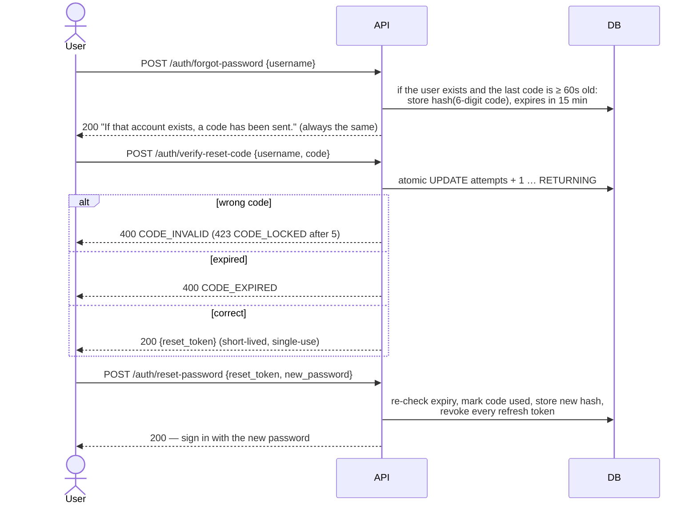

- **Code:** [`app/features/auth/reset.py`](../../backend/v1/app/features/auth/reset.py).
- **Codes are stored only as hashes.** The same response for unknown usernames means the endpoint can't be used to discover accounts.
- **UI:** [`frontend/src/features/login/ForgotPasswordPage.jsx`](../../frontend/src/features/login/ForgotPasswordPage.jsx), a three-step form with a 60-second resend countdown.

## 4. Token refresh

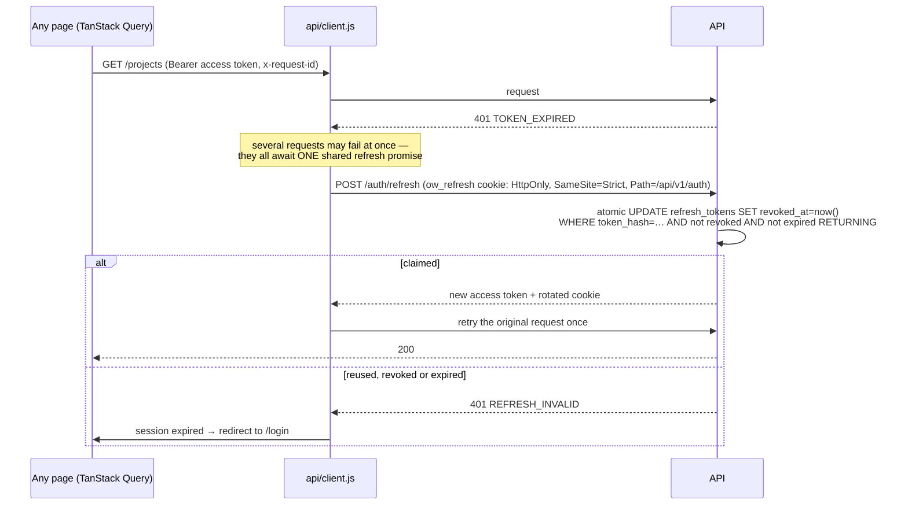

- **Server:** `refresh()` in [`app/features/auth/service.py`](../../backend/v1/app/features/auth/service.py). Claiming the token and revoking it is one statement, so a replayed cookie can only ever win once.
- **Client:** [`frontend/src/api/client.js`](../../frontend/src/api/client.js). Concurrent callers share a single `refreshing` promise, and each request is retried at most once.
- **Storage:** the access token lives only in memory. When the page reloads, [`SessionProvider.jsx`](../../frontend/src/auth/SessionProvider.jsx) restores the session from the cookie.

## 5. Time approval and the over-40-hour alert

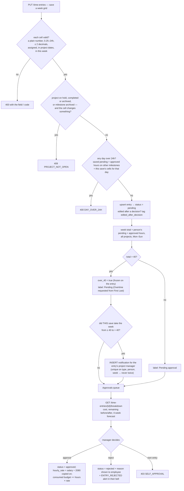

- **The over-40 flag** and the "did this save cross 40" test are pure functions in [`app/rules/overtime.py`](../../backend/v1/app/rules/overtime.py), along with `hourly_rate()`.
- **The week save, labels, approve and reject, and the breakdown** are in [`app/features/time/service.py`](../../backend/v1/app/features/time/service.py).
- **One alert per person-week** is guaranteed twice: by the crossing check, and by a unique constraint on `(type, subject_user_id, week_start)`.
- **The forecast** is consumed + (the average approved cost over the last 4 complete weeks × the weeks left until the predicted end date).
- **Input:** `_hours()` takes a JSON number or text of digits and one point only, so `"1e1"`, `"+5"`, `"-3"` and letters never become hours; negatives, more than 24, under 0.25 and a third decimal each get their own message. The grid blocks the same keys (`-`, `+`, `e`, letters) and refuses a paste that isn't already a clean value, rather than cleaning `"-3"` into `3`.
- **24 hours a day:** `_check_daily_cap()` runs after every cell is valid and before anything is written. A day counts what the server would hold after the save: the person's pending and approved hours on live work that day, with each saved cell replacing its old value. Rejected hours and archived work don't count (spec §3.1). The grid adds up the same way and, before saving, marks that day's cells, header and total and shows "More than 24h on <day>"; Save stays disabled until it's fixed.
- **Over 40 is a warning, not a block:** the overtime request is the point of the 40-hour rule, so the grid shows "This week is 45h — 5h over 40h. Hours above 40 are sent to your manager as an overtime request." and turns the week total amber, and the save goes through.
- **Closed projects:** logging is open on `planned` and `active` projects. On hold pauses it, completed closes it, and archived projects or milestones can't change. `_validate_cell()` refuses a cell there with `409 PROJECT_NOT_OPEN` only when it would write something (new hours, changed hours or note, a clear, or a resubmission); an unchanged cell is skipped. The week rows carry the project's `status` and `open`, so the grid greys those rows out, disables their cells (existing hours stay visible), hides **Resubmit**, and labels them "Project on hold — logging paused" or "Project completed — logging closed".
- **Who saves a week:** employees, and managers or admins whose `tracks_own_hours` an admin turned on ([`app/rules/timesheets.py`](../../backend/v1/app/rules/timesheets.py) `keeps_timesheet`). Anyone else gets `403 TIMESHEET_DISABLED` before any cell is read. The Friday reminder and the "Missing timesheets" list follow the same rule.
- **Approve week:** `POST /approvals/approve-week` checks every entry exactly like a single approval, then writes them all in one transaction; one stale or already-decided entry stops the batch.
- **UI:** [`TimesheetPage.jsx`](../../frontend/src/features/timesheet/TimesheetPage.jsx), the Timesheets area ([`TimesheetsPage.jsx`](../../frontend/src/features/timesheets/TimesheetsPage.jsx): To review, Approved, HR submission), [`ApprovalRow.jsx`](../../frontend/src/features/approvals/ApprovalRow.jsx), [`BreakdownPanel.jsx`](../../frontend/src/features/approvals/BreakdownPanel.jsx) and [`NotificationBell.jsx`](../../frontend/src/components/NotificationBell.jsx).

## 5a. Timesheet lifecycle: draft → pending → approved → submitted to HR

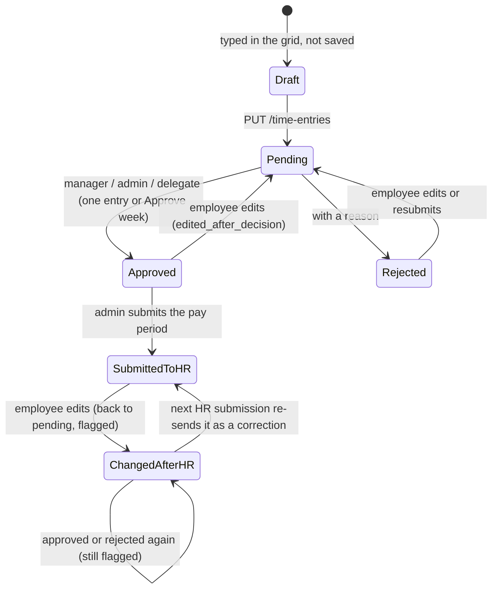

- **Draft** is only in the browser: nothing exists on the server until the week is saved. Saving makes every new or changed cell **pending**.
- **Submitted to HR** is an admin action per pay period (a week up to 31 days) in [`app/features/hr/service.py`](../../backend/v1/app/features/hr/service.py). It takes every approved entry in the period not yet sent, in one transaction, locking the rows (`FOR UPDATE`) so two admins can't send the same entry. Each entry is sent once. What was sent is copied row by row into `hr_submission_entries`, so the payroll CSV of a submission never changes afterwards. There's no HR system: the submission row says "Submitted to HR (export ready)" and its **Payroll CSV** is built in the browser from `GET /hr-submissions/{id}/entries` through `lib/csv.js` (formula-injection safe): one line per person per type, Regular or Correction.
- **Not locked (owner's decision).** Sent hours follow the normal rules: an employee can still edit them (they go back to pending) and the manager approves or rejects them again. Any edit to a sent entry sets `changed_after_hr_submission` and `hr_changed_at` and keeps `hr_submission_id`. The Timesheets area shows "Changed after HR submission — re-send" on the entry (To review) and on its week (Approved), and the admin's HR tab lists them under **Needs re-submission (N)**.
- **Corrections:** once a changed entry is approved or rejected again it's *ready*. The next submission (any period; the admin can untick "include corrections") re-sends it as a correction row with the hours sent before (`previous_hours`): its current hours, or 0 if it was rejected. The submission's `resubmission_of` points at the submission it corrects, and the flag clears. A changed entry still pending waits.
- **Who sees what:** admins submit, see every approved week with its cost, the corrections and the per-person payroll rows. Managers see their people's approved weeks (no cost: cost ÷ hours is a rate). Executives see the list of submissions with totals only.

## 5b. Archive and restore permissions

| | Archive | Restore | Sees it on the Archive page |
|---|---|---|---|
| Project | Admin | Admin | Admins; executives (read-only); the project's manager (read-only, "Only an admin can restore a project") |
| Milestone | Admin, the project's manager | Admin, the project's manager (while the project itself isn't archived) | Admins; the project's manager, with **Restore** |
| Person | Admin | Admin | Admins; executives (read-only) |

- **Code:** `load_milestone()` in [`app/authz.py`](../../backend/v1/app/authz.py) lets an archived milestone through only for someone who manages its project, so other managers and employees get `404`; `restore_milestone()` asks for `manage=True`. Projects stay admin-only at the route. [`app/features/archive/service.py`](../../backend/v1/app/features/archive/service.py) filters a manager's list to `p.manager_id = me`, leaves people out, and sets `can_restore` per item.
- **UI:** [`ArchivePage.jsx`](../../frontend/src/features/archive/ArchivePage.jsx) shows **Restore** only where `can_restore` is true and hides the People filter from managers. Milestones are archived from the project's Milestones tab.
- **History:** a person's own profile ("My history") also lists their work on archived projects and milestones, marked *Archived* / *Project archived* / *Project completed*, with nothing editable. Totals still leave archived work out. A manager looking at someone sees live work only.

## 6. The at-risk rule

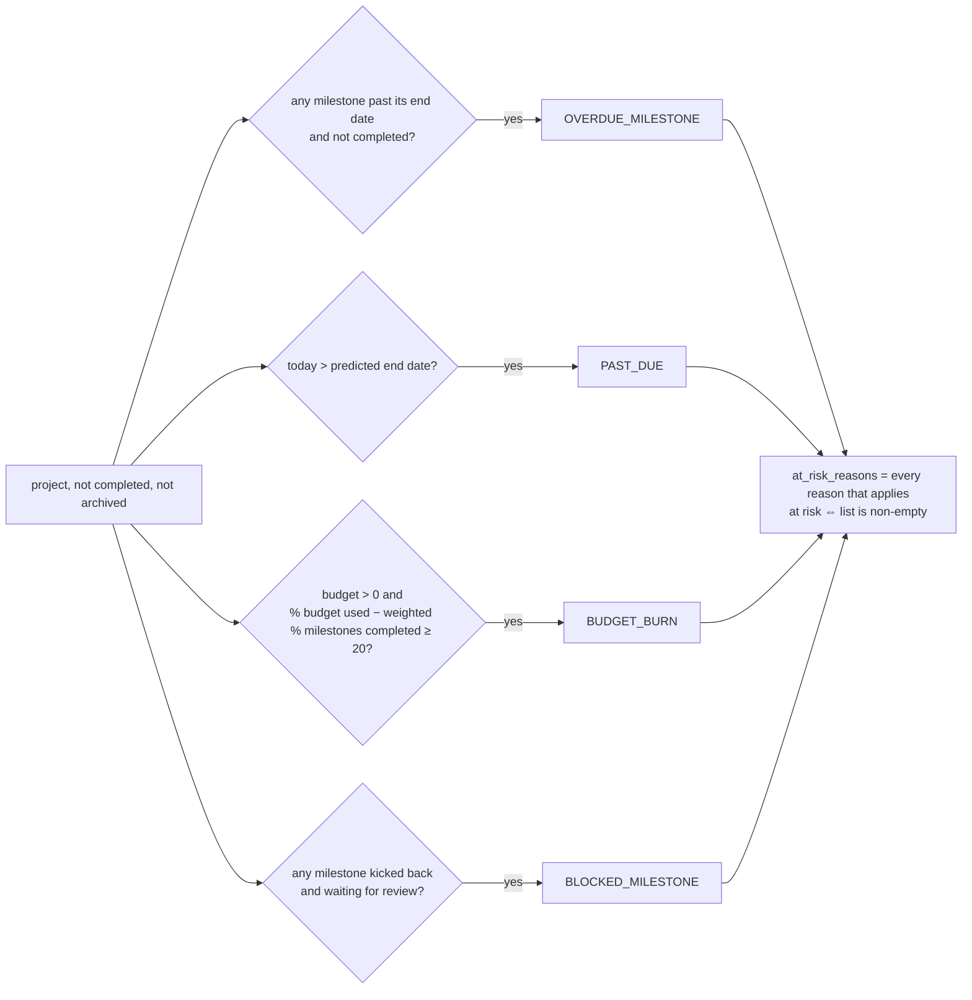

- **Code:** [`app/rules/at_risk.py`](../../backend/v1/app/rules/at_risk.py), a pure function of dates and numbers.
- **The inputs** (milestone counts, consumed budget) are gathered in one query by [`app/features/insights/`](../../backend/v1/app/features/insights/) and [`projects/`](../../backend/v1/app/features/projects/).
- **Completed % is weighted by difficulty** (easy 1, medium 2, hard 3), the same figure as the project's progress.
- **A project with no milestones** counts as 0% complete, so spending on it can flag burn.
- **`BLOCKED_MILESTONE`** (a milestone with status `blocked`, see [§9b](#9b-kickbacks-and-escalation)): the dashboard's Risk tiles count these one by one (`blocked_count` per at-risk project) and list them under `milestones.blocked`.
- **Each reason is shown as a badge** by [`RiskBadges.jsx`](../../frontend/src/components/RiskBadges.jsx), on the dashboard, in the project list and on the project overview.

**Worked example:**
- **Atlas Customer Portal** in the demo data ended 4 days ago, and its *Build* and *Launch* milestones are past their end dates. It shows two reasons: *Past due date* and *Overdue milestone*.
- **Apollo** is healthy: 5.4% of its budget is used against 16.7% progress (its easy *Discovery* is done; medium *Schema Mapping* and hard *Cutover* are not).

## 7. Dependency loop detection


- **Code:** `creates_cycle()` and `dependency_order()` in [`app/rules/cycles.py`](../../backend/v1/app/rules/cycles.py). `dependency_order()` is a topological sort that the timeline uses, with ties broken by start date.
- **Waiting on dependencies** is computed (the view's `blocked: true`, shown as `display_status: "waiting"`, "Waiting on dependencies"). A waiting milestone can't move out of `not_started` ([`app/rules/milestone_status.py`](../../backend/v1/app/rules/milestone_status.py)). Until migration 009 this showed as "Blocked"; *blocked* now means a kickback ([§9b](#9b-kickbacks-and-escalation)).
- **Example:** with *Discovery → Schema Mapping → Cutover*, making *Discovery* depend on *Cutover* walks Cutover → Schema Mapping → Discovery. That reaches the milestone being edited, so the change is rejected.
- **UI:** the dependency picker is in [`MilestoneDialog.jsx`](../../frontend/src/features/milestones/MilestoneDialog.jsx), and the date bars in [`Timeline.jsx`](../../frontend/src/components/Timeline.jsx).

## 8. The planned 40-hour cap

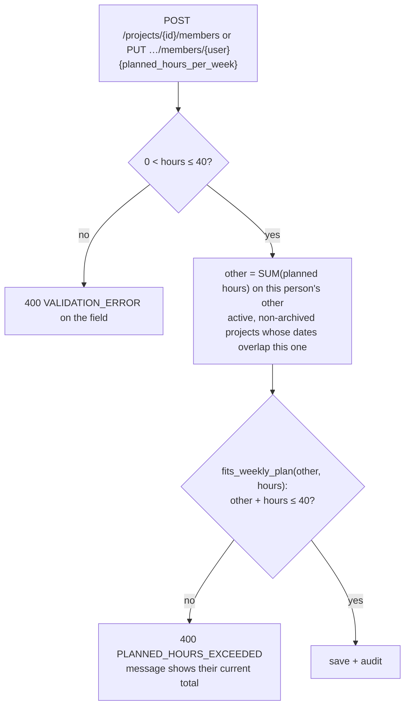

- **Code:** [`app/rules/capacity.py`](../../backend/v1/app/rules/capacity.py) holds the rule, and [`app/features/members/service.py`](../../backend/v1/app/features/members/service.py) runs the overlap query.
- **The cap is planned vs logged:** planned hours are a hard cap, while *logged* hours over 40 are only a warning (section 5). Allocation answers "who is over-planned?", and the dashboard's Q5 answers "who actually worked over 40?".

## 9. Auto-routing after "Ready for review" and "Completed"

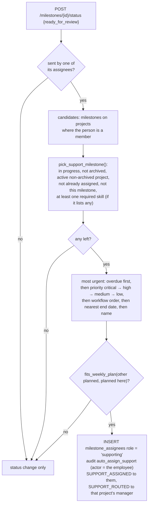

- **Code:** the choice is a pure function in [`app/rules/routing.py`](../../backend/v1/app/rules/routing.py). `route_to_support()` in [`app/features/milestones/routing.py`](../../backend/v1/app/features/milestones/routing.py) gathers the candidates and writes the result inside the status change's transaction, so either all of it happens or none of it does.
- **Planned hours don't change:** the person is already a member of the project, so they're only routed while their existing plan fits under 40 hours ([`app/rules/capacity.py`](../../backend/v1/app/rules/capacity.py), with the same overlap query as section 8).
- **Skills:** a milestone that lists required skills only takes someone with at least one of them; one that lists none can take anyone on the team.
- **Order:** overdue milestones first; then priority (critical, high, medium, low); then `next_milestone_order_key()` (the planned workflow order, see below); then the nearest end date; then the name, so the choice is stable. So a *critical* milestone due in 40 days beats a *medium* one due in 3, but any overdue milestone beats both. Priority never changes progress; that's difficulty's job.
- **They stay on the reviewed milestone**, in case the manager sends it back.
- **A manager moving the milestone** isn't routed anywhere unless they're one of its assignees.
- **Example:** Ada marks *Discovery* ready for review. The in-progress milestones on her projects that she isn't on are *Build* (ended 3 days ago) and *Cutover* (due in 5 days), so she's added to *Build* as support. She sees "You've been added as support on Build (Apollo), due …", and the project's manager sees "Ada Lovelace was auto-routed to support Build".
- **UI:** the toast after **Ready for review** names the milestone, and a "Supporting" chip ([`SupportingChip.jsx`](../../frontend/src/components/SupportingChip.jsx)) appears next to the person's name on the milestone card and on their timesheet row.

### 9a. After "Completed": the next milestone as primary

When the manager (or an admin) marks a milestone **Completed**, everyone who was on it (primary or supporting) frees up and may be made the **primary** assignee of the next ready milestone in the same project. It's assigned straight away (no accept step): the employee and the manager are told, and the manager can undo or change it with the normal assignee picker.

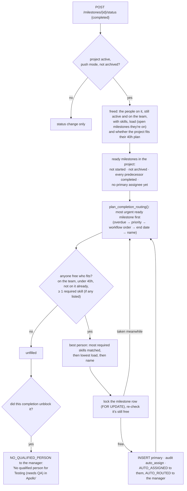

- **Code:** the decision is pure: `plan_completion_routing()`, `ready_for_routing()`, `person_fits()`, `tie_break()` and `next_milestone_order_key()` in [`app/rules/routing.py`](../../backend/v1/app/rules/routing.py), unit tested in `tests/unit/test_rules_routing_completion.py`. `route_after_completion()` in [`app/features/milestones/routing.py`](../../backend/v1/app/features/milestones/routing.py) gathers the facts and writes inside the status change's transaction.
- **Never bypassed:** a milestone with any non-archived predecessor not completed isn't ready. Nor is one that already has a primary assignee (no duplicate or conflicting assignments), one the person is already on, an archived one, or one on a planned, on-hold, completed, archived or **pull** project (in pull mode the team claims work, §11).
- **Status stays Not started.** Being assigned isn't starting: the person presses Start when they begin, which keeps "in progress" honest for the dashboard, the idle-milestone insight and the timeline.
- **Several people at once:** the most urgent ready milestone is filled first, by the person with the most of its required skills, then the lowest current load, then the name; each person gets at most one. The others go on to the next ready milestone.
- **Two completions at once** (different transactions) can pick the same milestone. Each locks the milestone row and re-reads it before inserting; the second waits for the first, sees its primary and moves on. Across transactions the first to commit wins; within one completion the tie-break above decides. Tested with two connections in `tests/integration/test_completion_routing.py`.
- **Nobody qualified:** milestones this completion unblocked that nobody could take get one `NO_QUALIFIED_PERSON` alert to the project manager, naming the missing skills.
- **Audit:** `auto_assign` (actor = whoever completed it), read as "Morgan Manager auto-assigned Ben Okafor to Cutover after Schema Mapping was completed (skill: Backend Development, DevOps)".
- **Workflow order:** `next_milestone_order_key(m)` returns `(m["sequence"] or 0,)`. Nothing selects a `sequence` yet, so every milestone ties and the end date decides; when milestones gain a workflow-order column, selecting it into the candidate rows is all it takes.
- **Demo:** completing *Schema Mapping* (Eli, Ana, Ben) unblocks *Cutover*, which needs Backend Development or DevOps. Ben has both, so he gets it.
- **UI:** the toast after **Complete** names who went where; the bell links straight to the milestone (`?tab=milestones&milestone=<id>`), where the manager can reassign it.

## 9b. Kickbacks and escalation

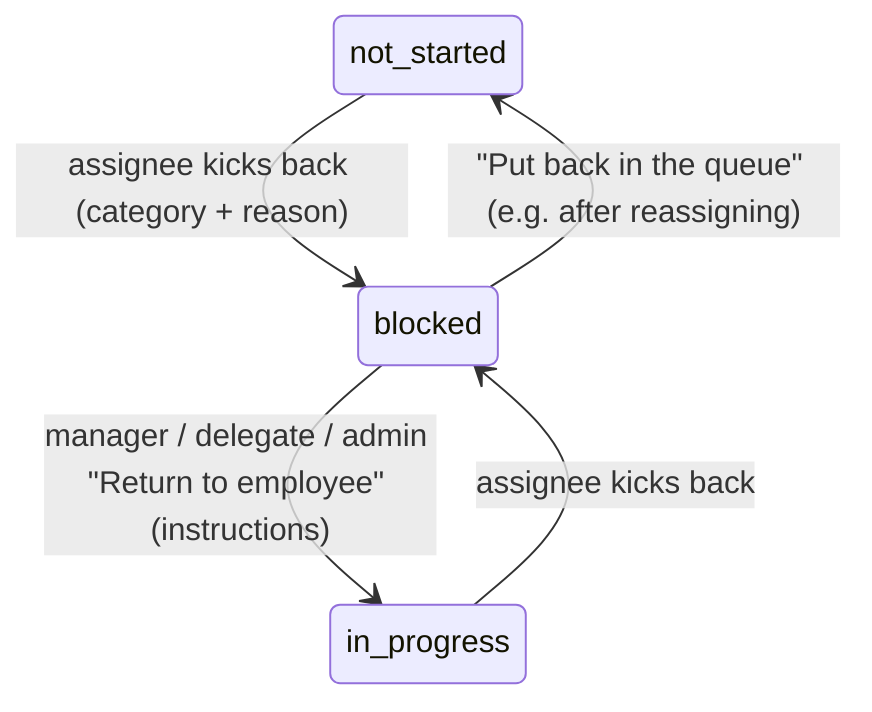

- **Who:** only the milestone's assignees kick back, and only work not yet handed in (`not_started`, `in_progress`). The project's manager, an admin, or the project's active delegate resolves it, with a note (instructions) that goes to the person who raised it and everyone on the milestone.
- **Never via the status endpoint:** `blocked` can't be set or left with `POST /status` (`can_transition()` refuses both), so every blocked milestone has exactly one open kickback (a partial unique index allows one open per milestone). While it's blocked the manager can still edit it and change its assignees.
- **Reason:** category `blocker`, `technical_issue`, `unclear_requirement` or `other`, and an explanation of 10 to 2,000 characters.
- **Alerts:** `KICKBACK_RAISED` to the manager and the active delegate ("Ben Okafor kicked back Cutover (Apollo Data Migration): Technical issue – …"); `KICKBACK_RESOLVED` back to the team.
- **Risk:** a blocked milestone adds `BLOCKED_MILESTONE` to its project's at-risk reasons (§6) and a high-severity `milestone_blocked` smart insight that leads the list (§10).
- **History:** `GET /milestones/{id}/history` returns every kickback with its resolution, and the milestone's audit events as sentences (status changes, assignment changes including auto-routing and claims, kickbacks, resolutions, edits, updates).
- **Code:** [`app/rules/milestone_status.py`](../../backend/v1/app/rules/milestone_status.py) (states), [`app/features/milestones/workflow.py`](../../backend/v1/app/features/milestones/workflow.py) (kickbacks, progress updates, history). UI: [`KickbackDialog.jsx`](../../frontend/src/features/milestones/KickbackDialog.jsx), [`KickbackPanel.jsx`](../../frontend/src/features/milestones/KickbackPanel.jsx), [`MilestoneHistory.jsx`](../../frontend/src/features/milestones/MilestoneHistory.jsx).

### Progress updates (the work log)

Assignees, the project's manager and admins post an update (1–2,000 characters, optional whole-number percent 0–100); anyone who can see the milestone reads them, newest first. The card shows the latest percent. The manager gets one `MILESTONE_UPDATE` alert per milestone, refreshed by each new update while unread. Audited as `post_update` ("Eli Employee posted an update on Schema Mapping").

### Skills

Admins keep the catalogue (`/skills`; migration 009 seeds eight). Admins set anyone's skills; a manager sets those of the **employees** they manage: direct reports and people on live projects they manage (the profile-visibility rule without the pending-hours clause), never their own or another manager's. Skills show on profiles, the people list and the project team. Archived skills stay attached but stop showing and stop counting for routing.

## 10. Smart insights

A "Smart insights" panel under the dashboard's Risk section, labelled *Rule-based suggestions from your live data*. It's plain rules over our own data: no AI and no outside calls (the Lambda has no internet access).

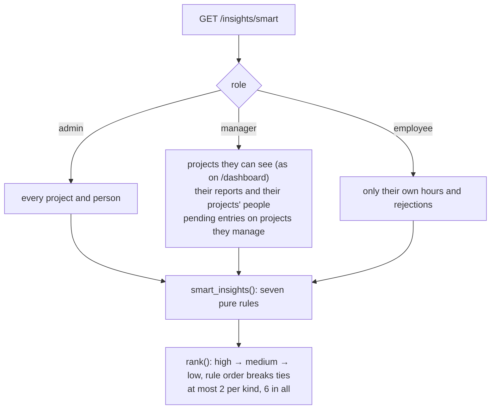

| Rule (`kind`) | Fires when | Severity | Links to |
|---|---|---|---|
| `budget_overrun` | Not completed, budget > 0, and the forecast at the end date (the dashboard's forecast) is above the budget | high | project |
| `milestone_overdue` | A milestone on a non-completed project is past its end date and still *not started* or *in progress* | high | project's milestones |
| `over_allocated` | Someone has more than 40 logged hours (pending + approved) this week | high | person |
| `budget_burn` | Not completed, budget > 0, and % budget used − weighted % complete ≥ 20 points (the at-risk `BUDGET_BURN` threshold) | medium | project |
| `milestone_due_soon` | Due in the next 0–7 days and still *not started* or *in progress* | medium (high for a critical or high-priority milestone) | project's milestones |
| `rebalance` | Paired with each over-40 person: the least-loaded person under 20h (50% of 40h), preferring someone who shares a project with them, each suggested once | medium | the person with spare time |
| `approval_backlog` | Entries waiting for this manager (not their own) whose work date is more than 3 days ago | medium | approvals |
| `idle_milestone` | An *in progress* milestone on a project that isn't on hold has had no pending or approved hours for 14+ days (counted from its start if nobody ever logged) | medium | project's milestones |
| `rejections` | Someone has had 2+ entries rejected in the last 30 days | low | person |

- **Code:** the rules and thresholds are pure functions and constants in [`app/rules/insights.py`](../../backend/v1/app/rules/insights.py), unit-tested in `tests/unit/test_rules_insights.py`. [`app/features/insights/smart.py`](../../backend/v1/app/features/insights/smart.py) gathers the data with the dashboard's own scoping helpers (`visible_projects`, `_people_scope`, the same forecast).
- **Each insight** is `{id, kind, severity, title, detail, link}`; `detail` is one sentence with the actual numbers and names.
- **Priority raises deadline insights:** an overdue or due-soon milestone whose priority is *critical* or *high* goes up one severity level (due soon: medium → high; overdue is already high) and the title names it: "Critical milestone Cutover is due in 3 days", "High-priority milestone Launch is overdue". Within each of the two kinds, critical and high milestones come first, so they survive the 2-per-kind cap.
- **Employees get insights, not a 403:** `/dashboard` is open to every role and filtered to what you may see, so this follows the same pattern. An employee only hears about themselves (over 40 hours, repeated rejections), never about budgets, projects or colleagues.
- **No salary or rate leaves the server.** Rates only feed the cost totals that `/dashboard` already shows as money.
- **UI:** [`SmartInsightsPanel.jsx`](../../frontend/src/features/dashboard/SmartInsightsPanel.jsx). Each row has a severity icon and colour plus a *High/Medium/Low* chip (so colour isn't the only signal), the title, the detail and a link. With nothing to say it shows "No suggestions right now". It shares the dashboard's query key, so approvals and project edits refresh it.

**Worked example (demo data, as `manager.demo`):** Eli has 45h logged this week (*high*); Ana, on the same project, has 0h, so she's suggested to take some of his work (*medium*); Ben's hours from last Thursday are still pending (*medium*); and Ana has had two entries rejected this month (*low*).

## 11. Pull mode: claiming a milestone

Each project works in **push** mode (the default: its manager assigns people, as before) or **pull** mode, set by the project's manager or an admin in the project dialog. In a pull project, people on the team pick up ready work themselves.

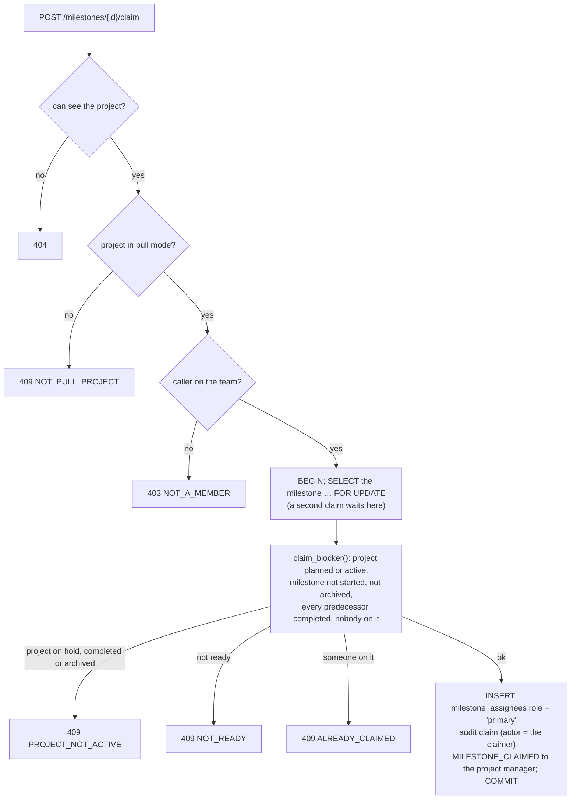

- **Code:** the eligibility check is a pure function, `claim_blocker()` in [`app/rules/claim.py`](../../backend/v1/app/rules/claim.py). `claim_milestone()` in [`app/features/milestones/service.py`](../../backend/v1/app/features/milestones/service.py) locks the milestone row, re-reads its status and the project's status, assignees and predecessors, and writes the assignment, the audit entry and the notification in one transaction.
- **Race:** the row lock means two claims at once can't both win. The second waits for the first to commit, then sees an assignee and gets `409 ALREADY_CLAIMED` (tested with two real database connections in `tests/integration/test_claim.py`).
- **Who can claim:** active team members only. The manager and admins (unless they're on the team) assign through the milestone dialog, as in push mode, which still works in pull projects.
- **The 40-hour cap is unchanged:** claimers are already on the team, so their planned hours don't move; the cap is checked when someone joins a team (section 8). Manager assignments don't check it either.
- **The list says what's claimable:** each milestone has `claimable` (pull project that's planned or active, ready, nobody on it) and `can_claim` (claimable and the caller is on the team), from the same `claim_blocker()`.
- **UI:** [`MilestonesTab.jsx`](../../frontend/src/features/milestones/MilestonesTab.jsx) shows a short pull-mode explanation and a **Claim** button on each milestone the viewer can claim; a lost race shows the server's message on that card. The manager's bell links to the project's milestones.
- **Example (demo data):** *Beacon Mobile App* is in pull mode. Gia and Hugo are on its team; *Design* has nobody on it and nothing to wait on, so either can claim it. *Prototype* waits on *Design*, so it can't be claimed until *Design* is completed.

## 12. The dashboard's department filter

Admins keep a list of departments (the **Departments** page); people (set by an admin on the person's page) and projects (set by the project's manager or an admin) can each be in one.

- **Filtered on the server:** the dashboard sends `GET /dashboard?department=<id>`. [`visible_projects()`](../../backend/v1/app/features/projects/service.py) adds `p.department_id = :dept` to the same visibility query, so the status counts, risk section, active-projects table, deliverables, dependency links and budget chart all come from that department's projects. `over_allocated` keeps only that department's people, and `pending_approvals` only entries on its projects.
- **Why the server:** the response's milestone lists and budgets are built from the visible projects, so filtering the rows once there keeps every widget consistent, and nothing outside the department is sent.
- **Allocation widget:** `/allocations` returns each person's `department_id`, and the dashboard's "busiest people" table hides people from other departments.
- **The choice is in the URL** (`/?department=<id>`), so a filtered dashboard can be shared or reloaded. "All departments" removes it. The filter only appears once there's at least one department.
- **Smart insights follow it too:** the panel (section 10) sends `GET /insights/smart?department=<id>`, which uses the same `visible_projects(department=)` for the project, budget and milestone insights, keeps only that department's people for the hours and rejection insights, and counts only its projects' entries in the approval backlog.
- **Code:** [`DashboardPage.jsx`](../../frontend/src/features/dashboard/DashboardPage.jsx), [`app/features/departments/`](../../backend/v1/app/features/departments/) and [`DepartmentsPage.jsx`](../../frontend/src/features/departments/DepartmentsPage.jsx).

## 13. Avatar upload safety

Anyone can upload a profile photo, and everyone else's browser then displays it, so an upload is the easiest way to try to plant something in the app. The rule is simple: **the server never stores or serves what was uploaded, only a PNG it rebuilt from validated pixels.**

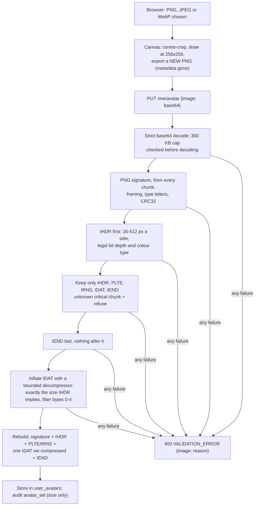

Each safeguard and what it stops:

| Safeguard | Where | What it stops |
|---|---|---|
| Re-encode in the browser (canvas → `toBlob('image/png')`) | [`lib/avatarImage.js`](../../frontend/src/lib/avatarImage.js) | EXIF/GPS and other metadata leaving the device; anything embedded in the original file. A convenience only: the server trusts none of it |
| Only PNG, JPEG or WebP can be picked; 15 MB source limit | `avatarImage.js`, [`AvatarDialog.jsx`](../../frontend/src/features/avatar/AvatarDialog.jsx) | SVG (which can carry script), HTML and GIF never reach the canvas |
| Strict base64, 300 KB cap checked on the text length before decoding | [`app/rules/png_sanitize.py`](../../backend/v1/app/rules/png_sanitize.py) `decode_base64()` | Oversized uploads costing memory; lenient decoding accepting junk |
| PNG signature required | `sanitize_png()` | SVG, HTML, GIF, JPEG and every other format: `not_png` |
| Every chunk's length, type letters and CRC32 checked | `_chunks()` | Corrupted or hand-crafted files |
| IHDR first, 16–512 px a side, legal bit depth / colour type / methods | `_header()` | Decompression bombs (512 x 512 caps the image at about 1 MB raw) and malformed headers |
| Only IHDR, PLTE, tRNS, IDAT, IEND kept; every other chunk dropped; an unknown *critical* chunk refused | `sanitize_png()` | Payloads and metadata in `tEXt`, `zTXt`, `iTXt`, `eXIf`, `iCCP` and private chunks |
| IEND must be last and nothing may follow it | `_chunks()` | Polyglots: a valid PNG with HTML or JavaScript appended (`trailing_data`) |
| IDAT inflated with `zlib.decompressobj().decompress(data, expected + 1)`; the result must be exactly the size IHDR implies, the stream must end cleanly and every row's filter byte must be 0–4 | `_inflate()` | Zip bombs (it stops after `expected + 1` bytes and never inflates the rest), truncated or padded image data, junk after the zlib stream |
| The stored file is rebuilt: new IHDR, kept PLTE/tRNS, **one IDAT we compressed ourselves** from the checked scanlines, new IEND | `sanitize_png()` | Anything that survived the checks inside the original byte layout: what's stored is our bytes, not the uploader's |
| Pure Python (`struct` + `zlib`), no image library | `png_sanitize.py` | Parser bugs in native image libraries; nothing native to ship in the Lambda package |
| Served with `Content-Type: image/png`, `X-Content-Type-Options: nosniff`, `Content-Disposition: inline`, `Content-Security-Policy: default-src 'none'`, `Cache-Control: private, max-age=300` | [`app/http.py`](../../backend/v1/app/http.py) `binary_response()`, [`app/features/avatars/routes.py`](../../backend/v1/app/features/avatars/routes.py) | The browser guessing another type (MIME sniffing), the file running script if opened directly, shared caches keeping someone's photo |
| Photos need a signed-in user; the browser fetches them with the bearer token as a Blob and shows an object URL | `api.blob()` in [`api/client.js`](../../frontend/src/api/client.js), `useAvatar()` in [`api/queries.js`](../../frontend/src/api/queries.js) | Photos being public URLs. A non-image answer (such as the CDN's HTML fallback) is treated as missing, never put in an `` |
| Only your own photo can be set; only admins remove someone else's | `routes.py` | One person replacing another's face |
| Audited as `avatar_set` / `avatar_remove` with the stored size only | [`app/features/avatars/service.py`](../../backend/v1/app/features/avatars/service.py) | Image bytes ending up in the audit log, while keeping a trail of every change |

- **Tests:** `tests/unit/test_png_sanitize.py` builds PNGs in pure Python (`zlib` + `struct`). It proves a valid PNG passes with its pixels intact and its `tEXt` gone, and that a bad CRC, a wrong signature, SVG text, HTML/JS appended after IEND, oversized or tiny dimensions, a too-large payload, a truncated file, a missing IEND, an unknown critical chunk, wrong-length or non-zlib image data, a bad filter byte and a 50 MB zip bomb are all refused. `tests/integration/test_avatars.py` covers the endpoints, headers, permissions and audit entries.
- **No request storms:** `GET /avatars` returns `{user_id: version}` for the people who have a photo, so lists draw initials for everyone else without a request. Each photo is fetched once per user and version and cached by react-query; its object URL is revoked when react-query drops it (30 minutes unused, replaced by a newer version, or on sign-out).

## 14. The Friday timesheet reminder

No scheduler and no new AWS pieces: the reminder is created **lazily** when its recipient loads the app.

- **When it's due:** from **Friday 14:00 until the end of Sunday, New York time**. The app keeps no per-user timezone (dates are UTC elsewhere), so the reminder uses `America/New_York`, computed by hand (US daylight saving: second Sunday of March to first Sunday of November, both at 2am) so the Lambda needs no tz database. The week is the New York week (Monday to Sunday) containing that moment.
- **Who is missing:** an active (not archived) **employee or manager** who is on the team of at least **one active project** (a live membership of a project with status `active` that isn't archived; planned, on-hold, completed and archived projects don't count) and has **0 counted hours** that week. Counted means `pending` or `approved`, exactly as for the 40-hour rule; a week with only rejected hours is empty, and hours on archived projects or milestones don't count. Admins are never reminded.
- **The pure rule:** [`app/rules/timesheet_reminder.py`](../../backend/v1/app/rules/timesheet_reminder.py) (`reminder_week`, `review_week`, `missing_timesheet`), unit-tested at the Friday 13:59 / 14:00 boundary in summer and winter, on Saturday, at Sunday 23:59 (already Monday in UTC) and Monday 00:00, plus rejected-only weeks and on-hold or archived projects.
- **Creating it:** `GET /notifications` calls `ensure_own_reminder()` before listing ([`app/features/reminders/service.py`](../../backend/v1/app/features/reminders/service.py)). If the caller is missing, it inserts `TIMESHEET_EMPTY` with `week_start` set and `ON CONFLICT (type, subject_user_id, week_start) DO NOTHING`, so it exists at most once per person-week, even after it's read. If they're not missing (they logged hours), an unread reminder for that week is marked read. The bell polls notifications on every page, so the reminder shows up wherever the person is; it links to that week's timesheet.
- **Missing timesheets card:** managers and admins see it on their home dashboard (`GET /timesheet-reminders`, same people scope and `department` filter as `/dashboard`). From Friday 14:00 it lists this week; before that it lists **last week**, the most recent week that should be complete, so the card is useful every day. Each name links to the person's profile (managers may open everyone in their scope).

## 15. CSV export and Print / PDF

- **CSV export** is built in the browser from the rows already loaded, so it always matches the screen, filters included (all filtered rows, not only the grid's current page; the audit log exports the page of entries on screen). Buttons: Projects, Allocation (one line per person and project for the week shown), Approvals, Audit log, Cost by milestone (Budget tab, with the total row; hours only for those who see them), People (admin) and Archive. Files are named `overwatch-<table>-<YYYY-MM-DD>.csv`.
- **Format** ([`lib/csv.js`](../../frontend/src/lib/csv.js)): UTF-8 with a BOM so Excel reads accents, CRLF line ends, RFC 4180 quoting (cells with a comma, quote or line break are quoted, inner quotes doubled), readable headers with units (`Budget (USD)`, `Progress (%)`), plain numbers (no `$`, `%` or thousands separators), ISO dates, and timestamps as ISO 8601 UTC. Yes/No for flags.
- **CSV injection:** a text cell starting with `=`, `+`, `-`, `@`, a tab or a carriage return gets a leading `'`, so a spreadsheet shows it as text instead of running it as a formula. Numbers are written as numbers, so a negative amount stays `-250`.
- **Print / PDF** (dashboard on the manager and admin homes, and the project Budget tab) calls `window.print()`; the browser's dialog offers "Save as PDF". The print stylesheet ([`app/PrintStyles.jsx`](../../frontend/src/app/PrintStyles.jsx)) hides the sidebar, top bar, buttons, filters and tabs, prints on white, keeps cards, table rows and charts from splitting across pages and fits charts to the page width. The theme switches to light while printing (`usePrinting()` in [`colorMode.js`](../../frontend/src/app/colorMode.js), driven by the button, `beforeprint`/`afterprint` and the `print` media query), so a dark-mode user still gets a light printout. A small print-only header shows the page title, who printed it with their role, and the date and time.

## 16. Roles and the executive's read-only guard

| | Admin | Manager | Employee | Executive |
|---|---|---|---|---|
| Home | Control centre + organisation dashboard | Dashboard with their approvals on top | My week | Organisation dashboard, marked **Read-only view** |
| Projects | All, edit, archive | Theirs (edit), others they're on | The ones they're on | All, every tab (hours included), no edits |
| My timesheet | Only with "Tracks own hours" | Only with "Tracks own hours" | Yes | No (they don't log hours) |
| Timesheets: To review, Approved | Everything | Their projects + delegated ones | No | No |
| Timesheets: HR submission | Submit, corrections, payroll CSV | No | No | The list of submissions, read-only |
| Allocation, smart insights | Everyone | Their people | Themselves only (insights) | Everyone |
| Archive | Everything, restores | Their projects' items, restores milestones | No | Everything, restores nothing |
| Audit log | Yes | No | No | Yes (no pay fields) |
| People, departments, project requests | Manage | Requests only | No | No (departments list only) |

The navigation follows the same table: **Timesheets** (`/timesheets`; `/approvals` redirects there, filters kept) for admins, managers and executives, and **My timesheet** (`/timesheet`) only for people who log hours. The sidebar's waiting count sits on Timesheets.
| Profiles | Anyone, with salary | Their people, no salary | Themselves | Anyone, never a salary (not even their own) |

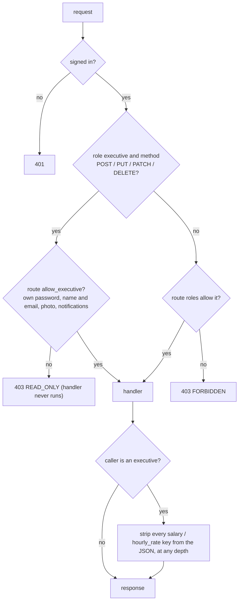

- **Code:** the guard and the stripping are in [`app/router.py`](../../backend/v1/app/router.py) (`_guard`, `_without_pay`), using `redact_pay()` from [`app/authz.py`](../../backend/v1/app/authz.py). `Ctx.sees_all` (admin or executive) widens what services read: `visible_projects`, `load_project` (archived projects too), the dashboard's and allocation's people, the archive and profiles. `manages()` stays admin-or-manager, so no edit path opens for an executive even before the guard.
- **Why central:** a write route added later is read-only for executives by default, and pay can't leak through a new response shape. [`tests/integration/test_executive.py`](../../backend/v1/tests/integration/test_executive.py) walks every registered write route and checks the opt-in list exactly, and checks the main read endpoints contain no `salary` or `hourly_rate` key (while the admin's audit log does).
- **Roles:** an admin creates executives from People like any role. An executive has no reporting manager, can't manage projects, join teams or be a delegate; moving a manager with projects or reports to executive is `409 HAS_DEPENDENTS`.
- **UI:** [`lib/permissions.js`](../../frontend/src/lib/permissions.js) answers no to every write action for executives (`isReadOnly()` labels the view), [`app/access.js`](../../frontend/src/app/access.js) and [`app/nav.jsx`](../../frontend/src/app/nav.jsx) give them Dashboard, Projects, Allocation, Archive and Audit log, and `canViewProfile` lets them open anyone.

## 17. Delegate approver

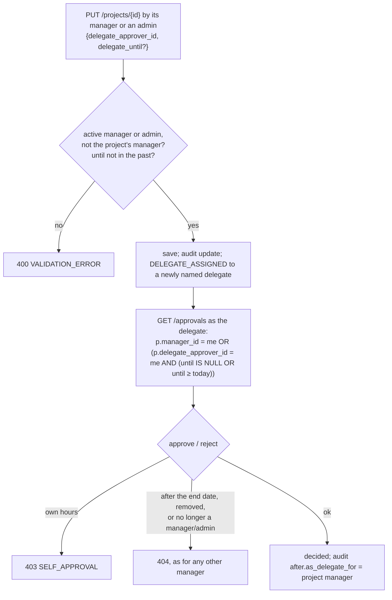

- **Active** means a delegate is set, today (UTC) is on or before `delegate_until` or there is none, the project isn't archived, and the delegate is still a manager or admin. `acts_as_delegate()` and `APPROVER_SQL` in [`app/authz.py`](../../backend/v1/app/authz.py) are that one rule, used by the queue and decisions ([`app/features/time/service.py`](../../backend/v1/app/features/time/service.py)), the dashboard's pending count, smart insights and which profiles a manager may open.
- **What a delegate gets:** the project's pending hours in their Approvals queue, labelled **Delegated from *manager***, the budget impact (cost, never an hourly rate unless they're an admin), approve and reject. Not other projects of the same manager, not their own hours, not the project's settings.
- **The manager keeps every right**; delegation adds an approver, it doesn't move the queue.
- **UI:** the project dialog's **Delegate approver** and **Delegate until** fields ([`ProjectForm.jsx`](../../frontend/src/features/projects/ProjectForm.jsx), sent only when changed), "Approvals delegated to *X* until *date*" on the project's Overview, and the label in [`ApprovalRow.jsx`](../../frontend/src/features/approvals/ApprovalRow.jsx). The bell's `DELEGATE_ASSIGNED` alert opens `/timesheets?project=…`.

## 18. Live activity and readable audit entries

`app/features/activity/service.py`. `summarize` turns audit rows into sentences: it collects every id the rows mention
(projects, milestones, time entries, users, requests, departments, and a `user_id` inside `changes`) and looks them up in
one query per table, then picks a verb per action and record type ("approved 9h for Eli Employee on", "moved … to In
progress", "marked Apollo completed", "created an account for"). Only hours and statuses are read from `changes`, so a
salary or rate can never reach a sentence. The audit log adds the summary to every entry; the redesigned Audit log page
groups entries by day ("Today", "Yesterday", then the date), shows an icon and colour per action, the actor's avatar
(a gear for System) and each changed field as "Status: In progress → Completed", with raw JSON behind a toggle.

`GET /activity` scopes in SQL, so `LIMIT` returns the newest events the caller may see. A CTE resolves each event's
project (directly, through its milestone or through its time entry) and whose hours a time-entry event is about, then:

- sign-ins and password events are dropped for everyone;
- admins and executives see the rest;
- managers: their own actions and decisions on their own hours; any event on a live project they manage or are the
  active delegate approver of (delegation not past its end date); milestone events on live projects they are a member
  of; and their own project requests;
- employees: their own actions, decisions on their own hours (so "Morgan approved 9h for Eli" reaches Eli), and
  milestone events on live projects they are on. A teammate's hours stay private.

`department` keeps only events whose project is in that department. The dashboard's Live activity card polls it with
the app's normal 30-second refresh; new items slide in (framer-motion), and nothing moves under reduced motion.

## 19. The command palette

`frontend/src/features/palette/`. Ctrl+K (Cmd+K on a Mac) anywhere, or "/" when the focus isn't in a field, opens a
search over pages (filtered by `ROUTE_ROLES` and `can`), the viewer's projects, people whose profile they may open
(admins and executives: everyone; managers: their allocation list; employees: themselves, checked with
`canViewProfile`), the milestones of their first 40 projects, and actions. Records are fetched only while the palette
is open and share the pages' react-query caches.

`phrases.js` is a fixed rule list (no AI, nothing leaves the browser), tried in order; the first match becomes an
"Interpreted" row shown as a chip such as "Projects · At risk · Technology":

| Phrase (examples) | Goes to | Who |
|---|---|---|
| "dark mode", "light", "switch to light mode" | switches the theme | everyone |
| "sign out", "log out" | signs out | everyone |
| "new project", "create a project" | `/projects?new=1` (admins) or `/requests?new=1` (managers) | admins, managers |
| "approvals", "pending approvals" | `/timesheets` (To review) | admins, managers |
| "who is over 40", "over-allocated", "overtime" | `/allocation` | admins, managers, executives |
| "overdue milestones" | dashboard (`/`), palette lists only the overdue milestones; employees `/projects?at_risk=true` | everyone |
| "budget of Apollo", "Apollo's budget" | `/projects/<id>?tab=budget` (best name match) | anyone who sees the project |
| "Eli's hours", "hours for Eli", "my hours" | Eli's profile; "my hours" the timesheet | when `canViewProfile` allows |
| "at-risk projects", "on hold", "active projects in Technology" | `/projects?at_risk=true&status=…&department=…` | everyone (the list is scoped) |

The projects page reads `department` and `new=1` from the URL (a removable "Department: …" chip shows the filter), and
the requests page opens its form on `new=1`.

## 20. Email this report and celebrations

"Email this report" (dashboard header; managers, admins, executives) builds the report in the browser
(`features/report/reportHtml.js`) from the dashboard data already on screen, so it follows the department filter:
headline numbers (at-risk projects, overdue milestones, pending approvals, budget used across projects), at-risk
projects with reasons, the top five smart insights and a budget table per project (budget, consumed, % used, forecast,
over-budget flagged). It uses only tables and inline styles, and every name passes through `escapeHtml`, so data can't
inject markup into the email. `relayReport` (`lib/emailRelay.js`) posts to EmailJS with the report template
`VITE_EMAILJS_REPORT_TEMPLATE_ID` (plus the existing service id and public key) and the parameters `to_email`,
`to_name`, `subject`, `from_name`, `report_html`, `app_url`. "Send to me" (on at first) sends to the signed-in
person's own email from `/me`; another typed address gets its own send, and results are listed per recipient.
Without the template id the button explains that email isn't set up instead of failing.

Confetti (`lib/celebrate.js`, canvas-confetti loaded on first use, skipped under reduced motion) fires in the browser
of the person who marks a milestone Completed, who approves the entry that empties every approvals list on screen, or
who moves a project to Completed (not when re-saving a project that already was).

## 21. Messages: who may message whom

`app/rules/messaging.py` decides, from facts the service loads; the server enforces it on every request and the
screen only offers what `GET /messages/contacts` returns (the compose picker and every **Message** button).
`start_blocker` takes the recipient's role and the employee's managers (`managers_of`) and is pure.

| Sender | May start a one-to-one with | May start a group | May reply |
|---|---|---|---|
| Admin | Any active person | Yes | In any conversation they're in |
| Executive | Any active person (messaging is a personal action, so these routes opt in to `allow_executive`) | Yes | In any conversation they're in |
| Manager | Any active person | Yes | In any conversation they're in |
| Employee | Their own manager (the one person they report to, `users.manager_id`), the manager of every live project they're on (not archived, not completed, still on the team) and that project's delegate approver while the delegation runs, and any other active employee. Never an admin or executive (unless one is their own manager or a delegate approver) or a manager they have no link to | No | In any conversation they're in, e.g. a group or Discuss thread a manager started |

Nobody may message themselves (`400`) or an archived person (`403 MESSAGING_NOT_ALLOWED`). An employee naming anyone
else (an admin, an executive, an unrelated manager) gets `403 MESSAGING_NOT_ALLOWED` "Employees can message their
manager, their project managers and other employees."; a group request is refused whole if any one recipient is refused. Someone who isn't a
participant gets `404` for the conversation, so ids reveal nothing. Replying to a one-to-one whose other person has
been archived is refused; the screen shows that thread read-only.

One-to-one conversations are unique per pair (`pair_key`): starting one again posts into the existing one. A
milestone's **Discuss** thread is a group with its active assignees, the project's manager and whoever opened it
(the project's manager or an admin), subject "*Milestone* · *Project*"; opening it again adds anyone assigned since.
Assignees open it from the milestone card ("Open discussion") once it exists but can't start it.

Unread counts are messages from others newer than your `last_read_at`; viewing a thread marks it read, and sending
counts as reading. "Seen" shows under your last message once every other participant's `last_read_at` is at or after
it. A new message gives each other active participant one `MESSAGE_RECEIVED` bell alert per conversation (refreshed,
not repeated, until they read it), and never includes the text. Sending is limited to 20 messages per person per
rolling minute (`429`). The inbox and unread badge poll every 5 seconds on Messages (30 elsewhere) and an open thread
every 3 seconds. Bodies are plain text: React escapes them and `white-space: pre-wrap` keeps line breaks; nothing is
turned into links or markup.

The seed (and `demo_backfill`, only while no conversation exists) adds a three-message thread between Morgan
Manager and Eli Employee and the Schema Mapping discussion with Eli, Ana and Ben, each leaving Eli one unread message.

## 22. Department presets and project templates

[`backend/v1/app/presets.py`](../../backend/v1/app/presets.py) holds one milestone plan per department, as pure
data and pure functions. Each step has a short objective, a weight (its share of the timeline), an effort estimate
in person-hours for a 26-week project, a difficulty, a priority, the steps it waits for and the job titles it needs.
Steps waiting for the same steps run in parallel and share dates.

| Department | Plan (→ waits for the previous step; ‖ runs alongside) |
|---|---|
| Technology | Discovery & requirements → Solution architecture → Build: backend services ‖ Build: frontend → QA & user acceptance testing → Release & cutover → Hypercare |
| Operations | Current-state assessment → Vendor & tool selection → Pilot rollout → Training & change management → Full rollout → Post-implementation review |
| Risk & Compliance | Scoping & risk assessment → Control testing (fieldwork) → Findings & draft report → Remediation planning → Remediation verification → Regulatory sign-off |

`plan_for(department, start, end)` lays a plan over the project's dates: the stages go back to back from the first
day to the last (largest-remainder split by weight, at least one day each), so every step starts the day after the
steps it waits for end. Each step's estimate scales with the days it gets (`scaled_estimate`). A project shorter
than its number of stages can't take the template.

`GET /project-templates` lists the plans for anyone signed in. On **New project**, picking a department that has a
plan shows **Start from the *Department* template** (ticked by default); with it, `POST /projects` gets
`template: true` and the server adds the plan's milestones (not started, nobody assigned, with dependencies,
difficulty, priority and estimate) in the same transaction as the project, audited as `apply_template`. Approving
a request can do the same with `{department_id, template: true}`. Department names match in any case.

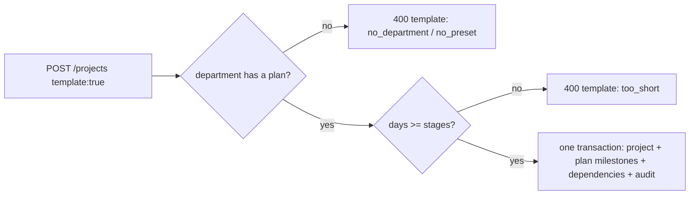

## 23. Curating the demo data (`demo_curate`)

[`backend/v1/app/curate.py`](../../backend/v1/app/curate.py), an operator-only Lambda operation (never HTTP). It is a
**dry run unless the event says `"dry_run": false`**: the dry run does all the same work inside a transaction and
rolls it back, so its summary is exactly what a real run would do. The seed runs the same code (without the audit
entries), so a fresh database and the curated live one match.

Safety rules: additive and archive-only. Nothing is deleted; no existing time entry, password, role, salary or
planned hours change; existing milestones keep their names, dates, status, hours and people (the only thing that may
be filled in on them is a missing estimate). A second run adds nothing.

1. **Leftover test items.** "Test milestone 2" in Apollo is archived if it exists and isn't a plan step; "Test
   project" is archived only if it has no team and no milestones. Archiving is the app's own soft archive, audited
   by System; their hours stay in the database.
2. **Merge the plan.** Existing milestones that stand for a plan step (same name or a known alias: Discovery →
   Discovery & requirements, Schema Mapping → Build: backend services, Prototype → Build: frontend, Design →
   Solution architecture, Cutover → Release & cutover, Requirements → Current-state assessment, Launch → Full
   rollout, Assessment → Current-state assessment, Audit Fieldwork → Control testing (fieldwork)) anchor it. A
   missing step goes in the gap between the steps around it; with no room there it starts the day after the step
   before ends and runs alongside the next one; with nothing left after the last step it finishes with the project.
   A step named in the plan that exists archived is never re-added.
3. **Status from today.** Completed project: completed. Active: in the past → completed, spanning today →
   in progress, later → not started, but never ahead of an earlier step that isn't done. Planned or on hold:
   not started. A step that would end up overdue is **not added** (a warning says so), so no project gets a new
   risk (Atlas's review is skipped this way).
4. **Dependencies.** A new step waits for its plan predecessors that end before it starts (otherwise for theirs, and
   so on back); an existing step waits for a new one before it when the dates allow and nothing gets blocked.
   Every edge is checked with `creates_cycle` first.
5. **People.** Push projects: a primary assignee (best job-title match among the team's people in the project's
   department) and a supporting one when a second person matches. If nobody on the team has the skill, one
   department colleague who has it joins with 10 planned hours a week, only if their 40-hour planned cap allows
   (Gia Rossi on Apollo). Pull projects (Beacon) stay unassigned so the team can claim; Design stays claimable.
6. **Approved hours history** for new steps that are done or under way on active and completed projects, up to the
   week before last: 4–8h on most weekdays, up to the person's planned hours on the project, never over 40h in a
   week or 8h in a day across all their entries; rate = salary ÷ 2,080, decided by the project's manager in the
   past. The latest days are dropped until spend stays at most 10 points ahead of progress and the forecast under
   90% of the budget; a completed project ends at 70–85% of its budget (Delta).
7. **Submitted timesheets** for last week and this week (up to yesterday), on active demo projects only: one
   overtime request just over 40h (with the `OVER_40H` alert the app sends), one entry rejected for the wrong day
   with its corrected resubmission (and the `ENTRY_REJECTED` alert), one normal 32–38h week, and everyone else's
   hours so far this week, with short notes. A person's week is left alone once it has pending or rejected hours.
8. **Estimates** on every demo milestone that has none (step 24).
9. One `curate_demo_plan` audit entry per changed project, by System, and a JSON summary per project (`added`,
   `dependencies_added`, `team_added`, `hours_added`, `pending_added`, `rejected_added`, `estimates_set`,
   `before`/`after` risk, budget and progress) plus `archived`, `timesheets` and `warnings`.

## 24. Expected time frame

`milestones.estimated_hours` (migration 013, optional, more than 0 and at most 10,000, one decimal) is the total
person-hours a milestone should take; the project's manager or an admin sets it, like priority (audited as
`update`). Nothing else is stored: [`app/rules/estimates.py`](../../backend/v1/app/rules/estimates.py) derives
`duration_days` (calendar days, both ends included), `working_days` (Monday to Friday) and `estimate_used_pct`
(counted hours, pending and approved, ÷ estimate). A project adds up its non-archived milestones:
`total_estimated_hours`, `logged_hours`, its own `duration_days`/`working_days`, and `estimate_used_pct` over the
milestones that have an estimate. Milestone cards read "Est. 120h · 30 days (22 working days)" and, once hours
exist, "86h logged · 72% of estimate", amber above 90% ("nearly used") and red above 100% ("over estimate"). The
project overview has an **Estimated effort** tile.

`demo_curate` fills in estimates only where there are none: a completed milestone's estimate lands within 15% of
its logged hours, an open one's stays above them (at least 1.25 × logged), and one without hours gets the plan
step's estimate for its dates (or about 4h per working day per person for a milestone that isn't a plan step).
## 22. The planning board and finalizing a plan

A new project starts **Planned** (always, when it starts from a department template: its milestones are a plan to finalize). While it is planned and its plan isn't finalized, the project page opens on a **Plan** tab: a Kanban board of the project's milestones in three columns, **Backlog → Ready → Scheduled**. The project's manager or an admin shapes the plan there; everyone else who can see the project (team members, executives) sees it read-only. Finalizing the plan checks it, moves the project to **Active** ("into execution") and locks the board.

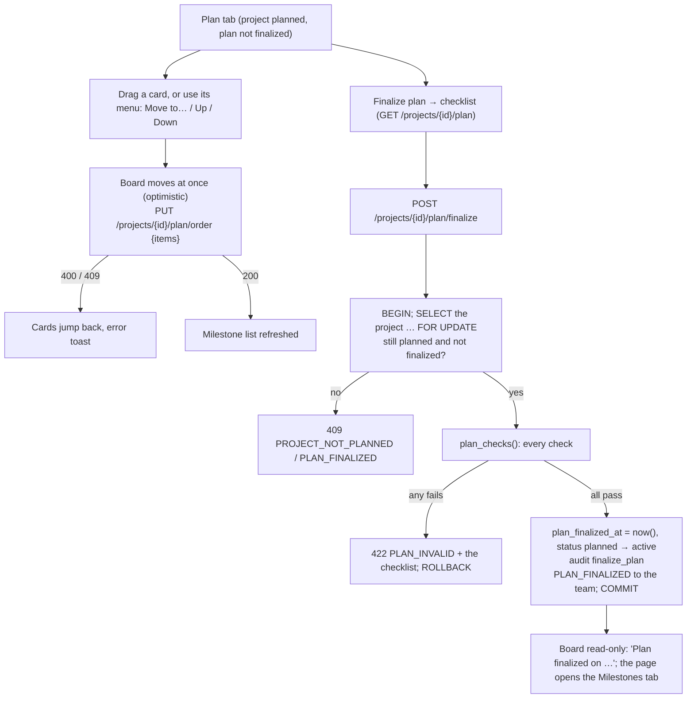

**Cards and order.** Each card is a milestone (name, priority, difficulty, due date, assignees, "after *X*" for its dependencies, required-skill chips when the milestone has them, and a warning icon listing anything that would fail a check). Its column is `milestones.plan_column` and its place in the column is `milestones.sequence` (from 1); the Scheduled column's order is the order the work happens. A card is created with **Add a card** in a column (a name only, dated across the whole project, then the milestone dialog opens to fill in dates, people and dependencies), edited in the usual milestone dialog, given a priority from its menu and archived from its menu (with a confirmation). Milestones added elsewhere land at the end of Scheduled.

**Moving cards.** Drag a card by its handle with the mouse or a finger, or from the keyboard: focus the handle, Space or Enter to lift, arrow keys to move within and between columns, Space or Enter to drop, Escape to cancel; a screen reader hears where the card is at each step. Every card also has **Move to…** (another column), **Up one place** and **Down one place** in its menu. Each move sends the whole board's order in one `PUT /projects/{id}/plan/order`, applied in one transaction with the project row locked, so a move can't land after the plan was finalized. The screen moves the card before the server answers and puts it back if the server refuses.

**The checks** are a pure function, `plan_checks()` in [`app/rules/planning.py`](../../backend/v1/app/rules/planning.py), over the project's live (non-archived) milestones. The checklist always lists all six, in this order:

| Check | Fails when |
|---|---|
| At least one milestone is scheduled | Scheduled is empty |
| Nothing is left in Backlog or Ready | Any card is still in Backlog or Ready. Finalizing is blocked until every card is scheduled (or archived): the plan is the whole plan |
| Dates inside the project | A scheduled milestone starts before the project's start date or ends after its predicted end date |
| Someone assigned | A scheduled milestone has nobody on it: the initial assignment is part of the plan, in pull projects too |
| Dependencies stay inside this project and form no loop | A dependency points to another project's milestone, or milestones depend on each other in a loop (`in_cycles()`, built on `creates_cycle()` from [section 7](#7-dependency-loop-detection)) |
| No milestone is ordered before one it depends on | In Scheduled, a milestone sits above (has a lower `sequence` than) a milestone it depends on |

The cards show the same problems before anyone presses Finalize (`cardWarnings()` in [`board.js`](../../frontend/src/features/planning/board.js)), and the Plan tab shows how many checks still fail.

**Finalizing** (`finalize()` in [`app/features/planning/service.py`](../../backend/v1/app/features/planning/service.py)) re-runs the checks inside the transaction that changes the project, so what is checked is what is finalized. On success the project gets `plan_finalized_at`, moves from planned to active, and the audit log records `finalize_plan` with the before and after. Everyone on the project (active members and assignees) and its manager, except whoever finalized, gets a `PLAN_FINALIZED` bell alert, "Beacon Mobile App plan finalized: your first milestone is Design", naming their own first milestone by plan order (`next_milestone_order_key()` in [`app/rules/routing.py`](../../backend/v1/app/rules/routing.py)), or the project's first milestone if they are on none. The alert opens the project's Milestones tab.

**After finalizing** the Plan tab stays, read-only, with "Plan finalized on *date*"; day-to-day work happens on the Milestones tab. A project that was never planned on the board (it was already active, or started without milestones) has no Plan tab.

**The status hook.** A planned project with live milestones can't be switched to active through the project dialog (`PUT /projects/{id}`): that returns `409 PLAN_NOT_FINALIZED`, because finalizing is the way into execution. A planned project with no milestones has nothing to plan and can still be started directly, as before the board.

- **Who:** the project's manager or an admin edit and finalize (`load_project(manage=True)`; executives are refused by the router like every write). Team members and executives see the board read-only.
- **UI:** [`frontend/src/features/planning/`](../../frontend/src/features/planning/): `PlanTab.jsx` (the board, built on `@dnd-kit` with pointer and keyboard sensors), `PlanColumn.jsx`, `PlanCard.jsx`, `FinalizeDialog.jsx` (the checklist) and `planningApi.js`. Cards read the same milestone list as the Milestones tab, so edits in the milestone dialog show on the board at once. On a phone the columns scroll sideways inside the board, one column at a time.
- **Example (demo data):** *Beacon Mobile App* is planned, and its board holds the Technology department plan. Discovery & requirements, Design, Prototype and Build: backend services are scheduled in that order (Hugo on Prototype; the pull project's other steps have nobody yet); QA & user acceptance testing is in Ready, Release & cutover and Hypercare in Backlog. Finalizing shows two failing checks: cards left outside Scheduled, and nobody on Discovery, Design or Build: backend services. Scheduling every card and assigning someone to each makes the plan pass. `demo_curate` numbers the steps it adds to the other projects' Scheduled column by date, as migration 010 does for existing milestones.
## 22. The public demo admin

The sign-in page's **Admin** button signs in as `demo.admin` (Dana Demo-Admin) with the published password `Demo123!`.
Anyone can use it, so the account is flagged `users.is_public_demo` (migration `012_demo_accounts.sql`) and the server
treats it as untrusted: guard rails on what it may change, a hard 5-minute session, and sign-in rules nobody can use
to lock others out. The real `admin.demo` account is a normal admin with a private password.

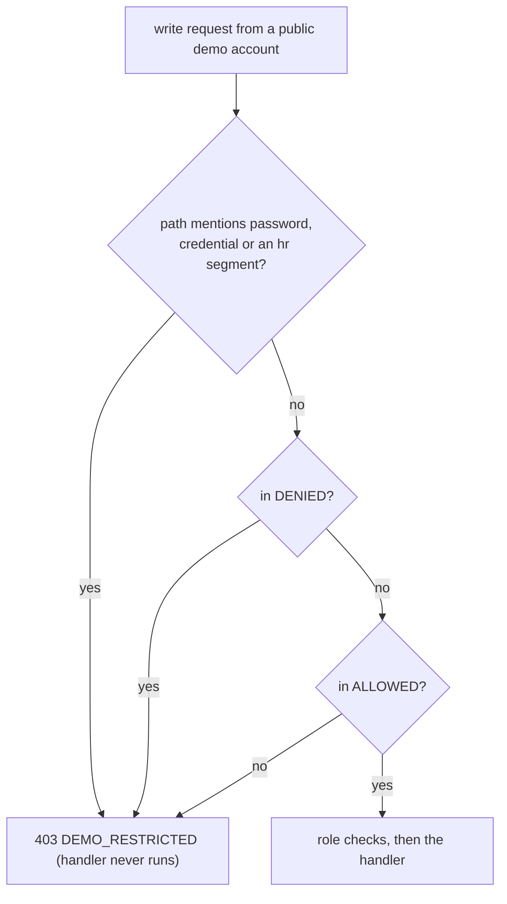

**Guard rails.** [`app/public_demo.py`](../../backend/v1/app/public_demo.py) holds both lists, each entry with the
reason; [`app/router.py`](../../backend/v1/app/router.py) checks them in `_guard`, after the executive check and
before the role check, for every `POST`, `PUT`, `PATCH` and `DELETE`. Reads are never restricted.

| Denied (`403 DEMO_RESTRICTED`, "Disabled in the public demo.") | Allowed |
|---|---|
| Its own account: password, name, email, photo (`/auth/change-password`, `PUT /me`, `/me/avatar`), so the next visitor finds it as published | Every read |
| People: create (admins included), edit (role, salary, manager, email, username, details), archive, restore, password resets, removing someone's photo | Approving and rejecting hours; logging its own hours |
| Projects: archive and restore | Creating and editing projects; deciding project requests |
| Departments: create, rename, archive, restore | Staffing: adding, changing and removing project members |
| By name, for routes added later too: anything with `password`, `credential` or an `hr` path segment (submitting timesheets to HR, which doesn't exist yet) | Milestones: create, edit, archive and restore, dependencies, assignees, progress, claim, notes |
| Any write route not reviewed yet (in neither list) | Messages, milestone discussions and notifications |

Why a denylist plus an allowlist rather than a per-route flag: a forgotten flag on a new route would quietly open it.
Here a new write route is refused for the demo until someone decides, and
[`tests/integration/test_public_demo.py`](../../backend/v1/tests/integration/test_public_demo.py) fails while any
registered write route is in neither list (and when a listed route no longer exists). The same file calls every denied
route as the demo admin (refused, nothing in the database changes) and as the real admin (it still works).

**The 5-minute session.** At sign-in the server sets the session end (sign-in time + 5 minutes, whole seconds):

- the access token carries it as `sxp` and its `exp` is never later (normally 15 minutes);
- the refresh token row stores it in `refresh_tokens.session_expires_at` and expires with it; a refresh copies the
  same end onto the new token, so refreshing can't extend it, and after it the refresh answers
  `401 DEMO_SESSION_EXPIRED`;
- a demo account's token without `sxp` (issued before the account was flagged) is refused, and so is a refresh token
  without an end.

The sign-in, refresh and `/me` responses carry `is_public_demo` and `session_expires_at` for the app. Code:
[`app/features/auth/service.py`](../../backend/v1/app/features/auth/service.py) (`_issue`, `refresh`),
[`app/security.py`](../../backend/v1/app/security.py) and [`app/ctx.py`](../../backend/v1/app/ctx.py).

**Sign-in.** Like the other published demo logins, wrong passwords never lock it (a lock would let one visitor shut
everyone else out) and forgotten-password codes are never sent. Instead each client address gets 20 sign-ins to a public
demo account per rolling minute (`429 RATE_LIMITED`), counted in `demo_login_attempts`. The address is CloudFront's
`CloudFront-Viewer-Address` header when present, else the Function URL's source IP. Both are best effort: a direct
caller can set the header to dodge the limit, but can't limit anyone else without knowing their address.

**In the app.** [`app/DemoSession.jsx`](../../frontend/src/app/DemoSession.jsx) shows a one-time welcome dialog and a
banner "Demo admin — for demonstration only. You'll be signed out in 4:32." with a live countdown; hiding it leaves a
counting chip in the header that brings it back. [`auth/SessionProvider.jsx`](../../frontend/src/auth/SessionProvider.jsx)
signs out at `session_expires_at` (or when a refresh answers `DEMO_SESSION_EXPIRED`) and the sign-in page says "Your
5-minute demo session has ended." [`lib/permissions.js`](../../frontend/src/lib/permissions.js) mirrors the denylist
(`demoBlocks`), and [`components/DemoLock.jsx`](../../frontend/src/components/DemoLock.jsx) shows those buttons
disabled with the tooltip "Disabled in the public demo". The server check is what protects the account; the screen
only explains it.

**Creating it.** `seed` creates it with the rest of the demo data; on an existing database `demo_backfill` adds it only
if no `demo.admin` exists, and never flags an existing ordinary account of that name.
## 22. Puppy, the rule-based assistant

Puppy is the small dog next to the bell (`frontend/src/features/puppy/`). It's labelled **"Puppy · your rule-based
assistant"** and its panel says "Puppy follows rules from your data — no AI service involved." The Lambda has no
internet access, so everything is fixed rules running in the browser. Puppy adds no backend endpoint and no new
polling: it reuses the bell's `GET /notifications` query and the caches the pages already use.

```mermaid
flowchart TD
  P[bell's notifications poll] --> D{"detectNew()<br/>first load? → silent"}
  D -- "new id + created_at,<br/>not about you within 5 s of your own save" --> G{"alert gate:<br/>last alert ≥ 5 s ago?"}
  G -- no --> W[wait, add the counts together] --> G
  G -- yes --> A[toast + aria-live 'Puppy: N new notifications'<br/>+ Puppy hops]
  A --> S{muted, 'None', or 'only in the background'<br/>while the tab is visible?}
  S -- yes --> Q[no sound]
  S -- no --> U{page interacted with yet?}
  U -- no --> H["no sound; the toast adds<br/>'Click anywhere to enable sounds.' (once)"]
  U -- yes --> PL[Web Audio plays the chosen sound]
```

- **What counts as new** (`detector.js`): the first load is silent. After that, a notification is new the first time its
  `id` + `created_at` is seen, so reading notifications never alerts, one read plus one arrival in the same poll still
  alerts, and a refreshed message alert (someone wrote again) alerts. An alert about you (`subject_user` = you) that
  shows up within 5 seconds of a save you made is treated as your own action and stays silent.
- **At most one alert per 5 seconds** (`createAlertGate`): a burst is added up and announced once when the gap ends.
- **Sound is never the only signal:** the bell's badge, Puppy's dot and raised ears, a toast and a polite screen-reader
  announcement always come, with or without sound. The tab title shows "(3) Scout" while notifications are unread
  (this can be switched off).
- **Sounds** (`sounds.js`) are made in code with the Web Audio API, with no files and no external URLs. *Puppy bark*
  (the default) is two quick woofs, each a sawtooth voice through a closing low-pass filter with a falling pitch plus a
  burst of band-passed noise; the second woof is lower and softer. *Soft chime* is two sine partials (C6, G6) with a
  long fade. *Ping* is a bright sine with a slight bend. *Pop* is a sine that drops two octaves in 70 ms. *None* is
  silent. Volume scales each envelope's peak.
- **Autoplay rules:** the `AudioContext` is created on the first click, key press or tap (or right away when the
  browser reports the page was already interacted with, such as the sign-in click), or by a ▶ preview.
- **Settings** (Sound tab: sound with a preview each, volume, mute, "Only when the tab is in the background", tab-title
  count) are stored per browser under `overwatch.puppy.sound`; reading never throws and bad values fall back field by field.

**The panel** has four tabs:

- **Summary:** up to 3 dismissible tips, then "What needs you" as plain sentences (`summary.js`). Examples: "2
  timesheets are waiting for your approval" (one per person-week, approvers only), "Your timesheet for this week is
  empty", "1 of your time entries was rejected", "2 unread messages from Morgan", "Eli Employee went over 40 hours this
  week", "2 of your people haven't logged hours for last week" (managers and admins). Notification types Puppy doesn't
  know get a generic sentence (the server's own message, or "3 new plan finalized notifications"), never an error.
  Below that are quick links and the top 3 smart insights.
- **Do it:** actions Puppy runs for you (`actions.js`). Each shows exactly what will happen ("Puppy will mark 5
  notifications as read.") and runs only after **Confirm**, as you, through the normal hooks and pages, so the server's
  role checks and the audit log apply as usual. The actions are: mark all read; open this week's timesheet; message my
  manager (employees: opens compose with them filled in, and you press Send); open pending approvals (approvers:
  approving stays a human decision); open the at-risk project; email this report to me (opens the dashboard's dialog
  with Send to me on, via `?report=email`, and you press Send); switch theme; change the alert sound. Puppy never
  approves, rejects, archives, deletes, or changes roles or money.
- **Ask:** a question box (`ask.js`), matched in the browser and never sent, stored or logged. In order, it checks:
  1. Do-it-for-me requests, shown with the same confirmation.
  2. Requests for pay or private details, which are refused: "I keep pay and private details out of reach — ask an
     admin through the proper page."
  3. "Why is *Atlas* at risk?", answered with that project's own `at_risk_reasons` from the project list you already get.
  4. The help library (`help.js`): the at-risk rule, weighted progress, priority, overtime and the 40-hour rule, 24
     hours a day, approvals, the Friday reminder, who can message whom, delegate approvers, executives being read-only,
     and auto-routing and work sent back.
  5. The command palette's phrase rules ("what's at risk?", "who is over 40?", "show critical milestones").

  A question about a person the palette's role rules hide gets "I can't share that."
- **Sound:** the settings above.

**Tips** (`tips.js`), at most 3:

- "Your timesheet for this week is empty — want me to open it?"
- "3 entries logged 3+ days ago are still waiting — open Approvals?" (approvers)
- "*Cutover* is critical and due in 2 days"

Dismissed tips are remembered per browser (`overwatch.puppy.dismissedTips`). Tip ids carry the week or day, so next
week's reminder shows again.

**Safeguards** (`privacy.js`, explained in the panel under "What Puppy can see"):

- **Only role-scoped data:** Puppy reads only the viewer's normal role-scoped endpoints (`/notifications`, `/approvals`,
  `/messages/unread-count`, `/messages/contacts`, `/timesheet-reminders`, `/insights/smart`, `/projects`, milestones
  and the palette's people lists). The server is the final guard.
- **Allow-list and redaction:** `puppyView()` cuts every response to an allow-list of fields before any rule sees it.
  `redact()` drops salary, hourly rate, cost, passwords, codes, tokens, email, phone, message body, notes, subjects and
  audit `changes` at any depth. `redactText()` masks email addresses, passwords, one-time codes and long digit runs
  inside free text.
- **Tests:** they seed every one of those keys into every response, for every role, and check that nothing reaches
  Puppy's sentences, tips, actions, answers or the screen. Other tests check that a question never appears in any
  request or in storage, and that every action waits for Confirm.
