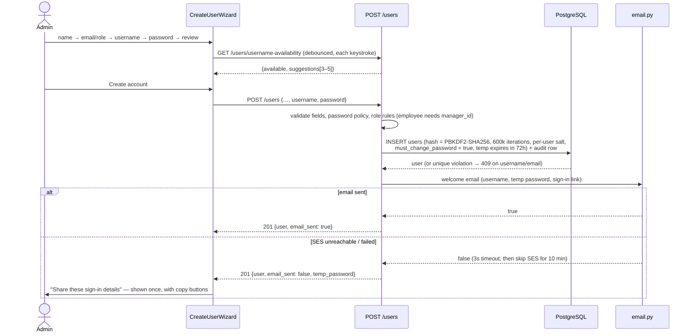
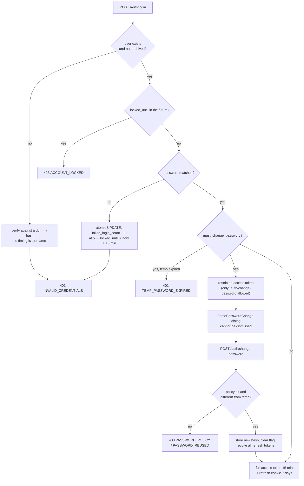
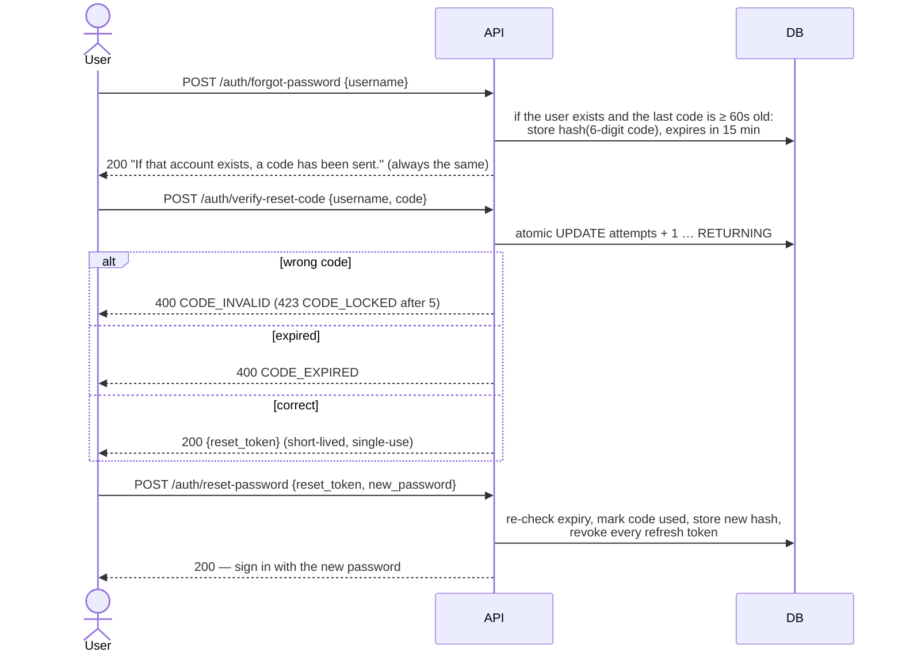
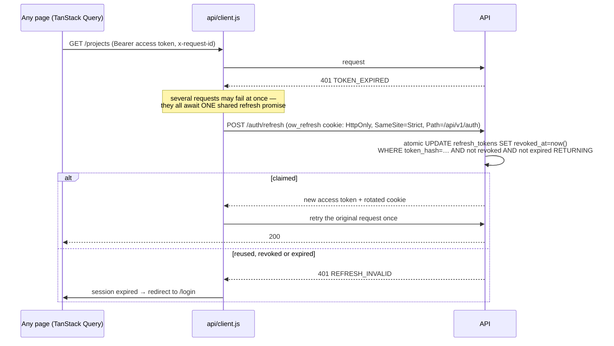
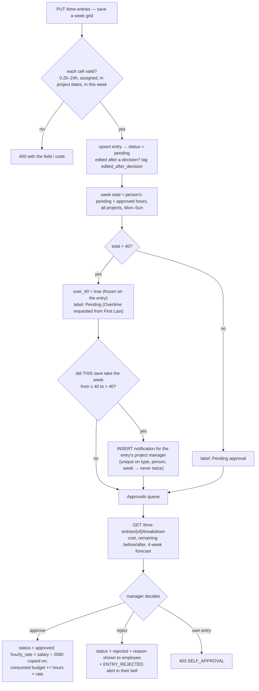
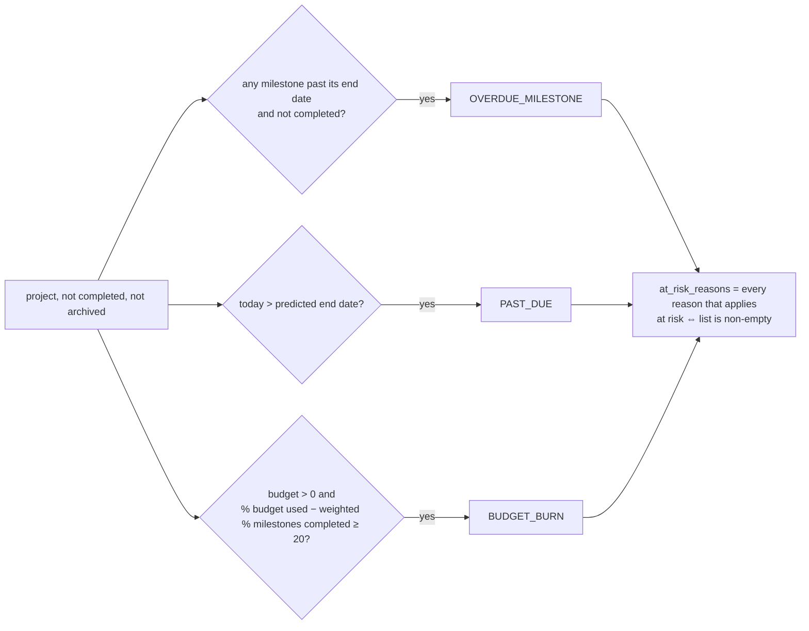
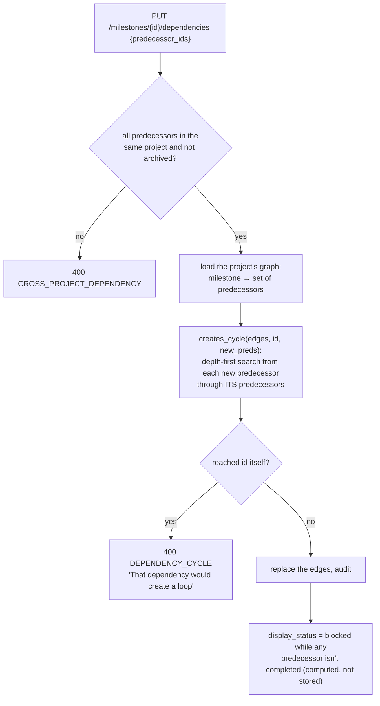
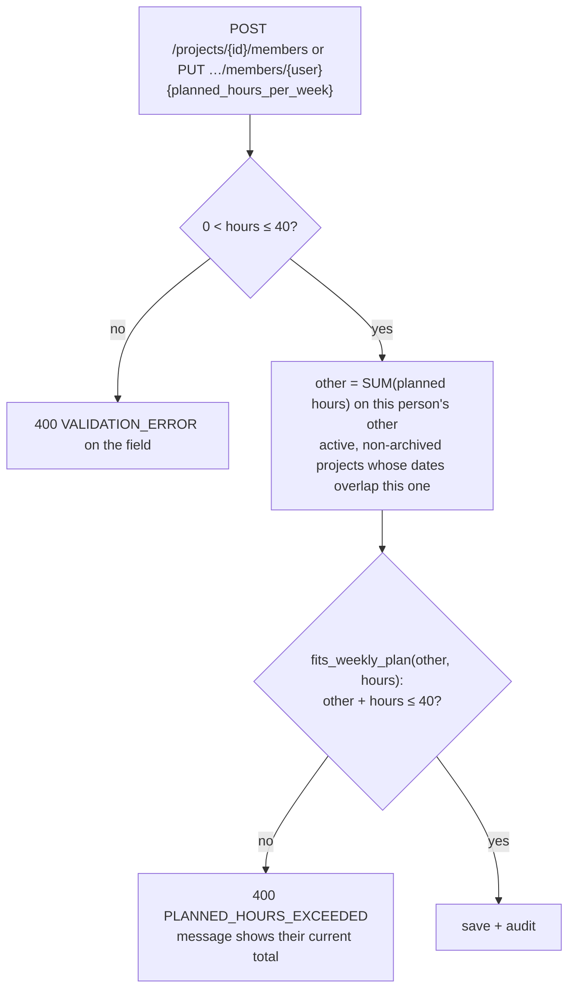
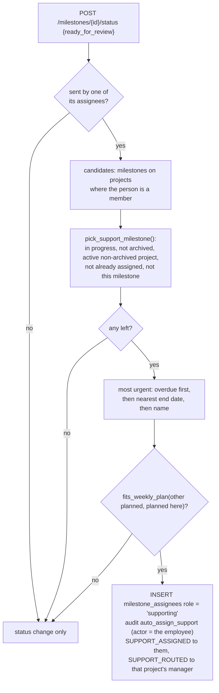

# Logic walkthrough

How the key flows and rules work, one diagram each, with links to the code that implements them. Paths are relative to the repo root.

Two patterns recur:

- **Business rules are pure functions** in [`backend/v1/app/rules/`](../../backend/v1/app/rules/). They take plain values, return plain values and never touch the database, so they're tested exhaustively (100% coverage) without one.
- **Race-prone steps are single SQL statements.** A step like "claim this refresh token" or "count this failed attempt" happens in one atomic `UPDATE … RETURNING`, so two requests can't both win.

---

## 1. Account creation and the welcome email

- **Username suggestions:** [`app/rules/usernames.py`](../../backend/v1/app/rules/usernames.py) builds candidates from the name (for Quinn Desktop: `qdesktop`, `quinn.desktop`, `desktopq`, `quinn_desktop`, `quinnd`, then numbered variants). The service drops the taken ones, comparing case-insensitively.
- **Account creation:** [`app/features/users/service.py`](../../backend/v1/app/features/users/service.py) and [`welcome.py`](../../backend/v1/app/features/users/welcome.py).
- **Email:** [`app/email.py`](../../backend/v1/app/email.py). Locally, every email is written to `backend/v1/.outbox/`. In the cloud it goes through SES, with fail-fast timeouts. Email failures never fail the request.
- **The wizard:** [`frontend/src/features/people/CreateUserWizard.jsx`](../../frontend/src/features/people/CreateUserWizard.jsx). **Next** stays disabled until the current step is valid.

## 2. Sign-in, lockout and the forced password change

- **Login, the lockout and the password change:** [`app/features/auth/service.py`](../../backend/v1/app/features/auth/service.py).
- **Hashing, tokens and the password policy:** [`app/security.py`](../../backend/v1/app/security.py).
- **The restricted token** carries a claim that the router checks. [`app/router.py`](../../backend/v1/app/router.py) returns `403 PASSWORD_CHANGE_REQUIRED` for every route except the ones marked `allow_restricted=True`.
- **UI:** [`frontend/src/auth/ForcePasswordChange.jsx`](../../frontend/src/auth/ForcePasswordChange.jsx), with the live [`PasswordPolicyChecklist`](../../frontend/src/components/PasswordPolicyChecklist.jsx).

## 3. Forgotten password

- **Code:** [`app/features/auth/reset.py`](../../backend/v1/app/features/auth/reset.py).
- **Codes are stored only as hashes.** The same response for unknown usernames means the endpoint can't be used to discover accounts.
- **UI:** [`frontend/src/features/login/ForgotPasswordPage.jsx`](../../frontend/src/features/login/ForgotPasswordPage.jsx), a three-step form with a 60-second resend countdown.

## 4. Token refresh

- **Server:** `refresh()` in [`app/features/auth/service.py`](../../backend/v1/app/features/auth/service.py). Claiming the token and revoking it is one statement, so a replayed cookie can only ever win once.
- **Client:** [`frontend/src/api/client.js`](../../frontend/src/api/client.js). Concurrent callers share a single `refreshing` promise, and each request is retried at most once.
- **Storage:** the access token lives only in memory. When the page reloads, [`SessionProvider.jsx`](../../frontend/src/auth/SessionProvider.jsx) restores the session from the cookie.

## 5. Time approval and the over-40-hour alert

- **The over-40 flag** and the "did this save cross 40" test are pure functions in [`app/rules/overtime.py`](../../backend/v1/app/rules/overtime.py), along with `hourly_rate()`.
- **The week save, labels, approve and reject, and the breakdown** are in [`app/features/time/service.py`](../../backend/v1/app/features/time/service.py).
- **One alert per person-week** is guaranteed twice: by the crossing check, and by a unique constraint on `(type, subject_user_id, week_start)`.
- **The forecast** is consumed + (the average approved cost over the last 4 complete weeks × the weeks left until the predicted end date).
- **UI:** [`TimesheetPage.jsx`](../../frontend/src/features/timesheet/TimesheetPage.jsx), [`ApprovalRow.jsx`](../../frontend/src/features/approvals/ApprovalRow.jsx), [`BreakdownPanel.jsx`](../../frontend/src/features/approvals/BreakdownPanel.jsx) and [`NotificationBell.jsx`](../../frontend/src/components/NotificationBell.jsx).

## 6. The at-risk rule

- **Code:** [`app/rules/at_risk.py`](../../backend/v1/app/rules/at_risk.py), a pure function of dates and numbers.
- **The inputs** (milestone counts, consumed budget) are gathered in one query by [`app/features/insights/`](../../backend/v1/app/features/insights/) and [`projects/`](../../backend/v1/app/features/projects/).
- **Completed % is weighted by difficulty** (easy 1, medium 2, hard 3), the same figure as the project's progress.
- **A project with no milestones** counts as 0% complete, so spending on it can flag burn.
- **Each reason is shown as a badge** by [`RiskBadges.jsx`](../../frontend/src/components/RiskBadges.jsx), on the dashboard, in the project list and on the project overview.

**Worked example:**
- **Atlas Customer Portal** in the demo data ended 4 days ago, and its *Build* and *Launch* milestones are past their end dates. It shows two reasons: *Past due date* and *Overdue milestone*.
- **Apollo** is healthy: 5.4% of its budget is used against 16.7% progress (its easy *Discovery* is done; medium *Schema Mapping* and hard *Cutover* are not).

## 7. Dependency loop detection

- **Code:** `creates_cycle()` and `dependency_order()` in [`app/rules/cycles.py`](../../backend/v1/app/rules/cycles.py). `dependency_order()` is a topological sort that the timeline uses, with ties broken by start date.
- **The blocked status** is computed in [`app/rules/milestone_status.py`](../../backend/v1/app/rules/milestone_status.py). A blocked milestone can't move out of `not_started`.
- **Example:** with *Discovery → Schema Mapping → Cutover*, making *Discovery* depend on *Cutover* walks Cutover → Schema Mapping → Discovery. That reaches the milestone being edited, so the change is rejected.
- **UI:** the dependency picker is in [`MilestoneDialog.jsx`](../../frontend/src/features/milestones/MilestoneDialog.jsx), and the date bars in [`Timeline.jsx`](../../frontend/src/components/Timeline.jsx).

## 8. The planned 40-hour cap

- **Code:** [`app/rules/capacity.py`](../../backend/v1/app/rules/capacity.py) holds the rule, and [`app/features/members/service.py`](../../backend/v1/app/features/members/service.py) runs the overlap query.
- **The cap is planned vs logged:** planned hours are a hard cap, while *logged* hours over 40 are only a warning (section 5). Allocation answers "who is over-planned?", and the dashboard's Q5 answers "who actually worked over 40?".

## 9. Auto-routing after "Ready for review"

- **Code:** the choice is a pure function in [`app/rules/routing.py`](../../backend/v1/app/rules/routing.py). `_route_to_support()` in [`app/features/milestones/service.py`](../../backend/v1/app/features/milestones/service.py) gathers the candidates and writes the result inside the status change's transaction, so either all of it happens or none of it does.
- **Planned hours don't change:** the person is already a member of the project, so they're only routed while their existing plan fits under 40 hours ([`app/rules/capacity.py`](../../backend/v1/app/rules/capacity.py), with the same overlap query as section 8).
- **They stay on the reviewed milestone**, in case the manager sends it back.
- **A manager moving the milestone** isn't routed anywhere unless they're one of its assignees.
- **Example:** Ada marks *Discovery* ready for review. The in-progress milestones on her projects that she isn't on are *Build* (ended 3 days ago) and *Cutover* (due in 5 days), so she's added to *Build* as support. She sees "You've been added as support on Build (Apollo), due …", and the project's manager sees "Ada Lovelace was auto-routed to support Build".
- **UI:** the toast after **Ready for review** names the milestone, and a "Supporting" chip ([`SupportingChip.jsx`](../../frontend/src/components/SupportingChip.jsx)) appears next to the person's name on the milestone card and on their timesheet row.
