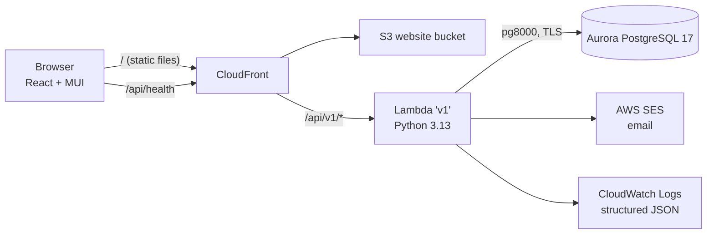
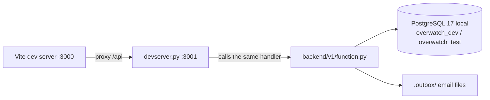
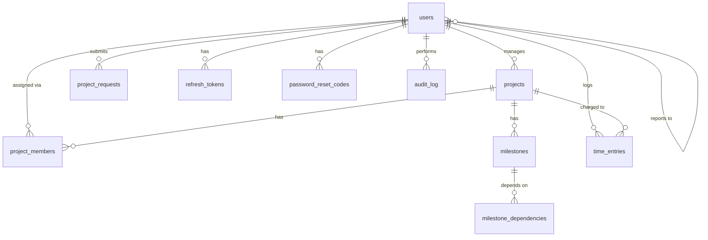

# Citi Overwatch – Design Spec

| | |
|---|---|
| **Status** | Draft for review |
| **Date** | 2026-10-13 |
| **Deadline** | Thursday 2026-10-15 (workshop day 3) |
| **Owner** | RootMoataz (solo) |
| **Repo** | New public GitHub repo `citi-overwatch` |

## 1. Goal

Citi Overwatch is a project tracking platform for ACME Inc. It gives admins, project managers and employees one place to manage projects, milestones, people, hours and budgets. It answers the seven questions in the workshop email.

**Done means** the app is live on AWS and reachable in a browser. It also runs locally from documented commands, meets every item in [REQUIREMENTS.md](../../project/REQUIREMENTS.md), and scores well on the [rubric](../../full-stack.md#evaluation-expectations).

### 1.1 Sources, in priority order

1. The workshop email, copied word for word in [REQUIREMENTS.md](../../project/REQUIREMENTS.md).
2. The project owner's group notes from the instructor's verbal briefing.
3. The repo's full-stack guide and rubric.

Other groups' designs (the "Object Structure V2" doc and the DBML schema) were reviewed for reference only.

### 1.2 Scope

- **Minimum:** everything in this spec.
- **Stretch:** items in [STRETCH.md](../../project/STRETCH.md). We start them only after the minimum is complete and verified.

## 2. Roles and permissions

There are three roles: `admin`, `manager` and `employee`. The backend enforces every permission in one central place. The UI hides actions a role can never perform, and disables actions that aren't possible right now, with a tooltip saying why.

| Action | Admin | Manager | Employee |
|---|---|---|---|
| Create, edit, archive and restore users; change usernames; reset passwords; edit salaries | ✅ | ❌ | ❌ |
| Edit own first name, last name and email | ✅ | ✅ | ✅ |
| See own salary | ✅ | ✅ | ✅ |
| See other people's salaries | ✅ | ❌ | ❌ |
| Create projects, approve or reject project requests, assign a project's manager | ✅ | ❌ | ❌ |
| Archive and restore projects | ✅ | ❌ | ❌ |
| Archive milestones | ✅ | ✅ own projects | ❌ |
| Restore milestones | ✅ | ❌ | ❌ |
| Submit a project request | — | ✅ | ❌ |
| Edit project description, dates, budget and status | ✅ all | ✅ own projects | ❌ |
| Assign employees to a project and set their planned weekly hours | ✅ all | ✅ own projects | ❌ |
| Create, edit and complete milestones; set dependencies | ✅ all | ✅ own projects | ❌ |
| Log own hours | ✅ | ✅ | ✅ on assigned projects |
| Approve or reject overtime | ✅ all | ✅ own projects | ❌ |
| See projects | All, including archived | Projects they manage or are assigned to | Assigned, non-archived projects |
| See the audit log | ✅ | ❌ | ❌ |

"Own projects" means projects where `projects.manager_id` is the current user.

A user can never raise their own role, edit their own salary, or act on a project they can't see. These attempts return `403`.

## 3. Domain rules

### 3.1 Archiving instead of deleting

- Nothing is hard-deleted. Every `DELETE` endpoint sets `is_archived = true` and `archived_at`, then returns `204`.
- Admins restore records with `POST …/restore`.
- Archived records are hidden from everyone except admins, and they're excluded from all calculations.
- Every archive and restore is written to the audit log.

### 3.2 Accounts and login

**Creating an account (admin only, step-by-step form):**

1. First and last name.
2. Email and role. Both stay disabled until step 1 is valid.
3. Username, typed or generated.
4. Temporary password, typed or generated.
5. Submit.

**Usernames:**
- Lowercase letters, digits, `.` and `_`, 3–20 characters.
- Unique regardless of capitals.
- Can only be changed by an admin.
- While the admin types, the form checks availability (debounced) and shows 3–5 available suggestions built from the name.

**Password policy (applies to every password):**
- At least 6 characters, at least 1 digit, at least 1 special character.
- The temporary and new password can't be the same.
- Generated passwords are 12 characters and include uppercase, lowercase, a digit and a special character.

**Hashing:** PBKDF2-SHA256 from the Python standard library, 600,000 iterations, with a per-user salt. Plain-text passwords are never stored or logged.

**Welcome email:** contains the username, the temporary password and a link to the login page. It's sent through AWS SES in the cloud and written to `backend/v1/.outbox/` locally. If sending fails, the admin sees the temporary password once, with a copy button.

**Temporary passwords** expire after 72 hours.

**First login:**
- A user with `must_change_password = true` receives a restricted token that can only call `POST /auth/change-password`. Every other endpoint returns `403 PASSWORD_CHANGE_REQUIRED`.
- The UI shows a full-screen dialog that can't be dismissed: new password, confirm password, and a live policy checklist.

**Forgotten password:**
- The user enters their username. The backend emails a 6-digit code that is valid for 15 minutes, single-use, and stored only as a hash.
- The response is the same whether or not the username exists.
- The code locks after 5 wrong attempts. Resending is limited to once per 60 seconds.
- After a successful reset, all of the user's sessions are revoked.

**Admin reset:** the admin issues a new temporary password, which sets `must_change_password` again and sends a new welcome email.

**Lockout:** an account locks for 15 minutes after 5 failed logins in a row.

**Tokens:**
- The access token is a JWT (HS256) valid for 15 minutes. The frontend keeps it in memory.
- The refresh token is valid for 7 days. It lives in an `httpOnly` cookie and is stored hashed in the database. It's rotated on every use and revoked on logout and on password change.
- The JWT signing secret is generated once by the first database migration and stored in the `app_secrets` table. The Lambda reads it at cold start. This means no infra change is needed for the secret.

### 3.3 Project requests

- A manager submits a request with a name, description, proposed start and end dates, a proposed budget and a reason.
- An admin approves it, which creates the project with the requester as its manager, or rejects it with a comment.
- Request statuses: `pending`, `approved`, `rejected`.

### 3.4 Projects

**Fields:**
- name: required, unique among non-archived projects
- description
- `start_date`: required
- `predicted_end_date`: required, on or after the start date
- budget: zero or more
- manager: required, and must be a user with role `manager` or `admin`
- status

**Statuses:** `planned → active ⇄ on_hold → completed`. Only the project's manager or an admin changes the status.

**Completing a project** requires every non-archived milestone to be `completed`. It sets `completed_at`.

### 3.5 Milestones and dependencies

- A milestone belongs to one project. It has a name, description, start date and end date. Both dates must fall within the project's dates, and the end date must be on or after the start date.
- **Stored statuses:** `not_started`, `in_progress`, `completed`. Only the project's manager or an admin completes a milestone.
- **Shown status `blocked`** is calculated, not stored. It applies while any predecessor isn't `completed`. A blocked milestone can't move to `in_progress` or `completed`.
- **Dependencies:**
  - A milestone can have many predecessors, all from the same project.
  - No self-dependencies and no loops. The backend searches the project's dependency graph for loops and rejects any that would form, with `400 DEPENDENCY_CYCLE`.
  - If a milestone starts before one of its predecessors ends, the UI shows a warning but still allows it.
- **Timeline (minimum):** each project shows a simple timeline with horizontal date bars and an ordered dependency list. An interactive graph view is a stretch item.

### 3.6 Assignments and the 40-hour week

- **Assignments:** a manager or admin assigns a person to a project with `planned_hours_per_week`, which must be more than 0 and at most 40.
- **Planned cap:** a person's planned hours across all their active, non-archived projects that overlap in dates can't exceed **40 per week**. Going over is rejected with `400 PLANNED_HOURS_EXCEEDED`, and the message shows the person's current total.
- **Reporting manager:** every employee has exactly one reporting manager (`users.manager_id`). This is separate from project staffing, so an employee can work on projects run by other managers.

### 3.7 Time entries and overtime

- **Who logs:** each user logs their own hours, per day and per assigned project, in a weekly grid (Monday–Friday shown; weekends allowed).
- **Limits:** 0.25–24 hours per entry. The user must be assigned to the project, and the date must fall within the project's dates. There's one entry per user, project and day.
- **Week:** an ISO week, Monday to Sunday.
- **Overtime rule:** if saving an entry would push the user's total counted hours for that week, across all projects, above **40**:
  - The entry's counted `hours` keep their previous value: 0 for a new entry, or the old value for an edit.
  - The requested value is stored in `pending_hours`, with `pending_status = pending_overtime`.
  - The UI shows the entry as **"Pending approval (overtime over 40h)"**, and the person is flagged as over-allocated for that week.
- **Approval:** the project's manager, or an admin, approves (`hours = pending_hours`) or rejects (the pending value is cleared). Each decision is audited.
- **Cost:** an hourly rate of `salary ÷ 2,080` is copied onto the entry when its hours are counted. That way, a later salary change doesn't rewrite past costs.

### 3.8 Budget

- **Planned:** `projects.budget`. The admin sets it at creation, and the project's manager can adjust it. Every change is audited.
- **Consumed:** the sum of `hours × hourly_rate` for the project's counted time entries. Pending overtime isn't included until it's approved.
- Shown as the amount consumed, the amount remaining and the percentage used.

### 3.9 At-risk rule

A non-completed, non-archived project is **at risk** if any of these is true. The app shows every reason that applies.

1. **Overdue milestone:** a milestone's end date has passed and it isn't completed.
2. **Past due:** today is after the project's predicted end date.
3. **Budget burn:** the budget is more than 0, and the percentage used is at least 20 points higher than the percentage of milestones completed. If the project has no milestones, the completed percentage counts as 0.

The calculation is a pure function, so it can be tested exhaustively without a database.

## 4. Answering the email's questions

There's **one shared dashboard**, filtered to what the viewer is allowed to see.

| Email question | Where it's answered |
|---|---|
| Q1 Current status of each active project | Status cards (count per status) and a project table with status, progress and risk |
| Q2 Projects at risk | At-risk list with the reasons as badges |
| Q3 Resource allocation across projects | Allocation view: people × projects, planned hours per week, utilization % |
| Q4 Key deliverables and their status | Milestones table, plus each project's Milestones tab |
| Q5 Over-allocated team members | "Over 40h this week" list: people with pending or approved overtime |
| Q6 Dependency chain | Each project's timeline and dependency list |
| Q7 Budget consumed vs. planned | A bar chart per project and the Budget tab |

## 5. Architecture



**Local development:**



- **One Lambda, `v1`**, discovered by `backend/v1/requirements.txt`. CloudFront routes `/api/v1*` to it, with caching disabled and the `Authorization` header forwarded.
- **Dependencies are pure Python only** (`pg8000`, `PyJWT`), so the package builds on Windows without Docker. No `pydantic` or `bcrypt`, because they need native builds; validation is a small in-house module.
- **The database connection** comes from the injected `POSTGRES_*` variables. When `IS_LOCAL=false`, it uses TLS (`sslmode=require` semantics). The connection is reused across invocations.
- **Migrations and seed data in the cloud** run through a direct, IAM-authorized invoke of the Lambda: `aws lambda invoke` with `{"op": "migrate"}` or `{"op": "seed"}`. Requests that come through the Function URL can't trigger these, because they always carry `requestContext.http`.

### 5.1 Backend layout

```
backend/v1/
  function.py            # Lambda entry: internal ops or HTTP routing
  requirements.txt       # pg8000, PyJWT
  app/
    http.py              # request parsing, responses, error format, request IDs
    router.py            # method + path → handler, auth and role checks
    db.py                # connection, transactions, query helpers
    security.py          # hashing, tokens, password policy, code generation
    validation.py        # field validators
    audit.py             # append-only audit writer
    email.py             # SES or local outbox
    features/
      auth/  users/  requests/  projects/  members/
      milestones/  time/  dashboard/  audit_log/
        (each: routes.py, service.py, repo.py)
    rules/               # pure functions: at_risk, overtime, cycles, capacity, usernames
  migrations/            # 001_init.sql, 002_….sql
  scripts/               # migrate.py, seed.py, devserver.py
  tests/                 # unit/ and integration/
```

### 5.2 Frontend layout

```
frontend/src/
  app/        # router, providers, theme, layout (sidebar + top bar)
  api/        # fetch client: token refresh, request IDs, error mapping
  auth/       # session context, route guards, forced password change
  components/ # DataTable, FormStepper, ConfirmDialog, StatusChip, RiskBadges, Timeline, EmptyState, ErrorAlert
  features/   # dashboard, projects, milestones, people, requests, timesheet, approvals, allocation, audit, profile
  lib/        # validation schemas (Zod), formatters, permission helpers
```

**Libraries:**
- MUI, React Responsive, React Router
- TanStack Query: refetches every 30 seconds and when the tab regains focus
- MUI X DataGrid and Charts
- React Hook Form with Zod

## 6. Data model

All primary keys are `uuid DEFAULT gen_random_uuid()` and never change. Every table has `created_at` and `updated_at`. Archivable tables also have `is_archived` and `archived_at`.



| Table | Key columns |
|---|---|
| `users` | `username` (unique on `lower()`), `email` (unique on `lower()`), `first_name`, `last_name`, `job_title`, `role` (`admin`/`manager`/`employee`), `salary` numeric(12,2) annual, `manager_id` → users (required for employees), `password_hash`, `must_change_password`, `temp_password_expires_at`, `failed_login_count`, `locked_until` |
| `refresh_tokens` | `user_id`, `token_hash`, `expires_at`, `revoked_at` |
| `password_reset_codes` | `user_id`, `code_hash`, `expires_at`, `attempts`, `used_at` |
| `app_secrets` | `name`, `value` (the JWT signing key, generated by a migration) |
| `projects` | `name`, `description`, `start_date`, `predicted_end_date`, `budget` numeric(14,2), `status`, `manager_id` → users, `created_by`, `completed_at` |
| `project_requests` | `requested_by`, `name`, `description`, `proposed_start`, `proposed_end`, `proposed_budget`, `reason`, `status`, `decided_by`, `decided_at`, `decision_comment`, `project_id` |
| `project_members` | `project_id`, `user_id` (unique pair), `planned_hours_per_week` numeric(4,1) |
| `milestones` | `project_id`, `name`, `description`, `start_date`, `end_date`, `status`, `completed_at` |
| `milestone_dependencies` | `milestone_id`, `depends_on_id` (unique pair; same project; no self-dependency) |
| `time_entries` | `user_id`, `project_id`, `work_date` (unique triple), `hours` numeric(5,2) counted, `hourly_rate` snapshot, `pending_hours`, `pending_status` (`pending_overtime`/null), `decided_by`, `decided_at`, `note` |
| `audit_log` | `actor_id`, `action`, `entity_type`, `entity_id`, `changes` jsonb (before/after), `request_id`, `created_at` (append only) |

Database `CHECK` constraints mirror the validation rules (dates in order, hours in range, budget ≥ 0) as a second line of defense.

## 7. API

- Base path: `/api/v1`. Bodies are JSON. The access token goes in `Authorization: Bearer <access token>`.
- **Status codes:** 201 created, 200 OK, 204 archived or no content, 400 validation, 401 not logged in or token expired, 403 not allowed, 404 not found or not visible, 409 conflict (duplicates), 423 account locked, 500 server error.
- **Error format:**

  ```json
  {"error": {"code": "VALIDATION_ERROR", "message": "…", "details": {"field": "reason"}, "request_id": "…"}}
  ```

- List endpoints support `q`, filters, `sort`, `page` and `page_size`.

| Area | Endpoints |
|---|---|
| Auth | `POST auth/login`, `auth/refresh`, `auth/logout`, `auth/change-password`, `auth/forgot-password`, `auth/verify-reset-code`, `auth/reset-password`; `GET me`; `PUT me` (name and email) |
| Users | `GET users?q=&role=&archived=`, `POST users`, `GET/PUT/DELETE users/{id}`, `POST users/{id}/restore`, `POST users/{id}/reset-password`, `GET users/username-availability?username=&first=&last=` |
| Requests | `GET project-requests?status=`, `POST project-requests`, `POST project-requests/{id}/approve`, `POST project-requests/{id}/reject` |
| Projects | `GET projects?q=&status=&manager=&at_risk=&archived=`, `POST projects`, `GET/PUT/DELETE projects/{id}`, `POST projects/{id}/restore`, `GET projects/{id}/summary` |
| Members | `GET/POST projects/{id}/members`, `PUT/DELETE projects/{id}/members/{userId}` |
| Milestones | `GET/POST projects/{id}/milestones`, `GET/PUT/DELETE milestones/{id}`, `POST milestones/{id}/restore`, `PUT milestones/{id}/dependencies` |
| Time | `GET time-entries?user=&week=`, `PUT time-entries` (saves a week grid), `GET approvals`, `POST time-entries/{id}/approve`, `POST time-entries/{id}/reject` |
| Insights | `GET dashboard`, `GET allocations?week=` |
| Audit | `GET audit-log?actor=&entity_type=&from=&to=` |

`GET /api/health` stays as a separate probe with no dependencies.

## 8. Frontend experience

**Pages:**
- Login, Forced password change, Forgot password
- Dashboard
- Projects (list and detail)
- Project requests
- People (admin: list, create wizard, detail)
- My timesheet
- Approvals
- Allocation
- Audit log (admin)
- Profile

**Project detail tabs:** Overview, Milestones (timeline and dependencies), Team and allocation, Budget, Hours.

**Feedback:**
- Skeleton placeholders while data loads.
- A success message (toast) after every change.
- Error messages next to the field they belong to.
- Error banners include the `request_id`.
- Empty states always say what to do next.
- Confirm dialogs before archiving.

**Layout:**
- Left sidebar on desktop; menu drawer on mobile (switch at the MUI `md` breakpoint, via React Responsive).
- Data grids turn into stacked cards on phones.

**Visual design:**
- A custom MUI theme with one brand color, a fixed spacing scale and type scale, and consistent status colors.
- The theme is built so dark mode can be switched on later.

**Accessibility:**
- Every input has a label.
- Every action works from the keyboard, with visible focus.
- Colors meet WCAG AA contrast.
- Status is never shown by color alone.

## 9. Observability and debugging

- Every request gets a `request_id`: the `x-request-id` header if the request sent one, otherwise a new UUID. It's returned in the response headers and in error bodies.
- Every log line is JSON: `request_id`, user ID, role, method, path, status, `duration_ms`, error code. Logs go to CloudWatch, or to the console locally.
- Unexpected errors are logged with a stack trace but return a generic `500` message, so internals are never leaked.

## 10. Testing

| Layer | Tool | What it covers |
|---|---|---|
| Rules (unit) | pytest | At-risk, overtime holding, loop detection, capacity cap, password policy, username suggestions, permission checks: exhaustive edge cases |
| API (integration) | pytest + local Postgres `overwatch_test` | Every endpoint, including success, validation, 401/403/404 and archive behavior. The schema is rebuilt every run, and each test runs in a transaction that's rolled back |
| Frontend (component) | Vitest + React Testing Library | Form stepper gating, policy checklist, forced-change dialog, data states (loading, empty, error), role-based hiding |
| End-to-end | Playwright (desktop and mobile viewports) | Admin creates a user → first login → forced change → dashboard; manager milestone with a dependency; employee logs overtime → manager approves → budget updates |

- **Targets:** at least 80% coverage on `backend/v1/app`, and 100% on `rules/`.
- Commands, results and known gaps are recorded in `docs/project/TESTING.md`.
- Test-driven development: each rule and endpoint starts with a failing test.

## 11. Local development and deployment

- **Local:**
  - PostgreSQL 17 installed natively. The local superuser password is `postgres`, used for local development only.
  - `scripts/migrate.py`, `seed.py` and `devserver.py`.
  - `npm run dev`, with the Vite proxy sending `/api` to port 3001.
  - All steps are copy-paste in the README.
- **Cloud:**
  - `./bin/deploy-backend.sh` (Terraform).
  - Lambda invoke for migrations and seed data.
  - `./bin/deploy-frontend.sh` (S3 and CloudFront).
  - The repo's Windows workarounds (`~/bin` shims) are documented.
- **Demo data:** about 5 projects, about 15 people, milestones with dependencies, logged hours including one overtime case and one at-risk project, plus a demo login for each role.

## 12. Documentation deliverables

- **Root `README.md`:** replaces the workshop README, which moves to `docs/WORKSHOP_README.md`. Covers the overview, architecture diagram, setup, run, deploy, demo logins, trade-offs and assumptions.
- **`docs/project/`:**
  - `REQUIREMENTS.md`, `STRETCH.md`
  - `USER_STORIES.md`: stories for each role, with acceptance criteria
  - `ARCHITECTURE.md`
  - `DATA_MODEL.md`
  - `API.md`
  - `LOGIC_WALKTHROUGH.md`: Mermaid sequence and flow diagrams for login, the forced password change, the reset, overtime approval, the at-risk rule and dependency loop checks
  - `TESTING.md`
  - `DECISIONS.md`

## 13. Key decisions

| Decision | Why |
|---|---|
| Milestones stand in for the email's "deliverables" | They're the instructor's term. One entity, so nothing is duplicated |
| `DELETE` archives | Meets the email's CRUD requirement and the instructor's no-delete rule |
| One `v1` Lambda | Shared code without copy-paste, one deploy, still organized by feature |
| Pure-Python dependencies only (`pg8000`, `PyJWT`, standard-library PBKDF2) | Packages on Windows without Docker or the VDI |
| Vitest and Playwright instead of Jest and Cypress | Vitest works with Vite out of the box. Playwright tests real mobile screen sizes and runs in parallel. The guide says "tools like" |
| Password policy: 6+ characters with a digit and a special character, temporary passwords that expire, a forced change | The owner's rule, hardened against guessing |
| Hourly rate = salary ÷ 2,080, copied onto each time entry | A documented assumption. Salary changes don't rewrite past costs |
| JWT secret stored in `app_secrets` | Avoids changing the Lambda's environment in Terraform |

## 14. Risks and open questions

| Risk | Mitigation |
|---|---|
| The platform-provided Lambda role may not allow `ses:SendEmail`, and SES sandbox only delivers to verified addresses | Ask the instructors. Fallback: the admin sees credentials once. Forgotten-password codes fall back to "contact an admin" if email is disabled |
| Graders expect the repo's `start-dev.sh` (Linux) setup | The README documents the Windows-native path. Confirm with the instructors |
| 3-day timeline | If behind, cut in this order: audit-log UI (logging stays), timeline polish, the allocation view's charts, project requests UI (the API stays) |
| Aurora isn't reachable from the laptop | Migrations and seed data run inside the Lambda through IAM invoke |

## 15. Schedule

| Day | Deliverables |
|---|---|
| **Tue Oct 13** | Spec and plan approved. Migrations, backend core (HTTP, router, errors, request IDs, auth, users), rule tests, local dev server, first `v1` deploy |
| **Wed Oct 14** | Projects, requests, members, milestones and dependencies, time entries and approvals, dashboard and allocations API with tests. Frontend shell, theme, auth flows, projects and milestones screens |
| **Thu Oct 15** | Timesheet, approvals, allocation, dashboard UI, people wizard, audit log. Playwright end-to-end tests, seed data, all docs, final deploy, full verification on the live site |
